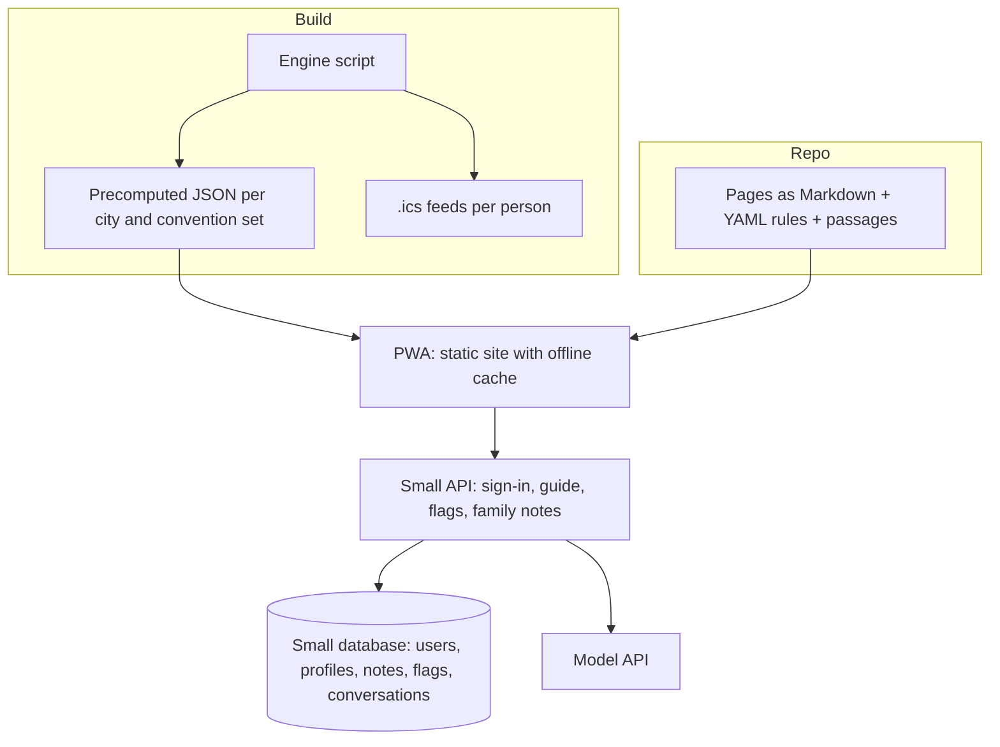
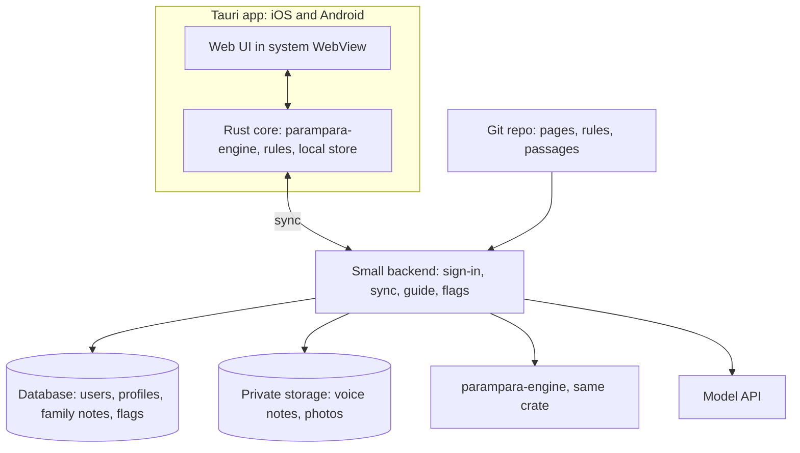

# Parampara (working title)

## Research dossier and product requirements for a Hindu calendar and AI companion app

Draft 0.1 · prepared 5 October 2026 · for founder review

---

## How to read this document

Part A is the research: who the users are, what already exists, how the Hindu calendar actually works, a seed catalogue of festivals and everyday traditions with their stories and reasons, an honest review of the scientific evidence, and lessons from earlier religious chatbots. Part B is the PRD built on that research. Appendices hold upcoming dates, a content schema, a sample event page, sample conversations, a glossary and the source list.

Bracketed numbers such as [3] point to sources I consulted during this research, listed in Appendix F. Material in the Hinduism sections that carries no number is standard reference knowledge (I name the text or tradition where I can). Treat it as seed content for editors, not as publish-ready copy: it needs review by people with real authority in the relevant traditions before it ships. Where sources disagreed, I say so instead of quietly picking one. Nothing here is legal advice.

"Parampara" (lineage, that which is handed down) is a placeholder name.

---

# Part A — Research dossier

## A1. The findings in brief

The audience is very large and already practising. Pew counts roughly 1.2 billion Hindus worldwide as of 2020, about 14.9% of humanity, with around 95% living in India [4]. Practice is centred on the home far more than on congregational worship: in India 55% of Hindus perform puja at home daily while only 20% do so at a temple daily, and 95% celebrate Diwali [3]. A product that helps with home observance is aimed at where the practice actually lives.

There is a funded market, but it is built around transactions. The category leader, Sri Mandir, reports over 40 million downloads and about 3.5 million monthly active users, earns from paid pujas and offerings, and was planning AI features for questions about faith, prayers and festivals as of mid-2025 [6]. Nobody prominent is positioned around understanding: the story, the "what do I do", and the "why".

Dates are a genuinely hard problem and the open web gets them wrong. During this research, reputable-looking pages disagreed on the dates of Navratri, Dussehra, Diwali, Janmashtami and Holi (details in A5.6). Festival dates depend on lunar day, local sunrise, regional convention and sectarian rules, so they must be computed per location by a deterministic engine, never recalled by a language model.

The "science behind traditions" space is mostly unsupported folklore dressed as fact. Widely copied lists assert, for example, that toe rings strengthen the uterus through a nerve, or that temples sit on magnetic fields [51]. Real peer-reviewed evidence does exist for some practices (yoga, slow breathing, the anxiety-reducing effect of ritual, the antibacterial effect of copper vessels), and it is usually narrower than the popular claim. Grading evidence honestly is a differentiator and a trust asset.

Religious chatbots have a poor track record. Gita-based bots launched in 2023 spoke in Krishna's voice, told users killing could be acceptable if it was their dharma, and expressed political opinions [12][13]. The lesson for this product is a set of hard design rules: never speak as a deity, ground every answer in reviewed sources, represent more than one tradition, and decline to issue rulings.

## A2. Audience and how Hindus practise today

Pew's 2019–20 survey of nearly 30,000 Indian adults is the best single dataset on lived practice [1]. Among Indian Hindus, 59% say they pray daily [1]. About three quarters (76%) do puja at home at least weekly, against roughly half (53%) who do so at a temple weekly [2]. Women carry more of the household ritual: 64% of Hindu women perform home puja daily compared with 47% of men [3]. Most Hindu households keep a holy basil (tulsi) plant [2].

Practice varies sharply by region. Only 30% of Hindus in South India report praying daily, compared with about 68% elsewhere in the country [1]. This matters for product design because "the Hindu user" does not exist. A Tamil Smarta family, a Gujarati Vaishnava family and a Bengali Shakta family keep different calendars, different principal festivals and different daily habits.

Diwali is close to universal: 95% of Indian Hindus celebrate it, as do large majorities of Jains and Sikhs and substantial minorities of other communities [3]. Hindus are also comfortable with plurality in practice; 17% of Indian Hindus say they take part in Christmas festivities [3].

The diaspora is small in share but strategically important. Pew's 2012 survey of Asian Americans found that 48% of Hindus prayed daily, 78% kept a home shrine, and only 19% attended a house of worship regularly [5]. Diaspora users face the sharpest version of the core problems: no grandparents nearby, festival dates that differ from the ones relatives in India mention, and children growing up without ambient exposure. They also spend more. Sri Mandir reported average revenue per user abroad of roughly ₹7,000 against ₹600–800 in India, with registered overseas users growing 15% quarter over quarter [6].

One first-person essay captures the emotional job well: a young Hindu professional, facing Hanuman Jayanti without his mother's guidance, wishes for a companion that explains rituals at his level without being preachy [11]. That is close to this product's brief.

## A3. Market and competitor landscape

IMARC values India's religious and spiritual market at about USD 70 billion in 2025 and projects USD 135 billion by 2034 [8]. That figure covers temples, pilgrimage, ritual goods and much else, so it is context rather than an addressable market. Venture funding for religious tech in India peaked at about USD 50.5 million in 2024 [6].

| Product | What it does | How it earns | Gap relative to this concept |
|---|---|---|---|
| Sri Mandir (AppsForBharat) | Online puja and offerings at partner temples, panchang, devotional audio; AI guidance planned | Takes a share of paid pujas and offerings; raised USD 20M Series C in June 2025 [6][7] | Transaction-led. Explanation and "why" are secondary. |
| VAMA, Utsav, DevDham | Similar virtual-temple and puja-booking models; VAMA reported about 600,000 monthly users [10] | Puja services, astrology, pilgrimage | Same model, smaller scale. |
| Drik Panchang | The reference panchang for many households: location-aware tithi, muhurat, festival dates | Advertising | Authoritative data, dense interface, little narrative or guidance. |
| AstroSage AI, AstroTalk | Astrology consultations, increasingly with AI astrologers [10] | Paid consultations | Prediction-focused, a different job and a different risk profile. |
| myBhakti and similar | Niche practice tracker for one tradition (Vaishnava japa, Ekadashi) | Free | Shows appetite for tradition-specific depth; narrow scope. |
| GitaGPT-style bots | Chat with a persona drawn from one scripture | Mostly free hobby projects | Single text, deity persona, weak grounding, documented failures [12][13]. |
| General AI assistants | People already ask them about festivals | Subscriptions | No location-accurate panchang, no family-tradition profile, no reviewed corpus. |

The open position is a calm, trustworthy explainer: accurate dates for where you live, the story, what your family's tradition does, why, and an honest account of what is and is not scientifically supported. About 30% of Sri Mandir's users are under 35 [6], which suggests the category is not only for older devotees.

## A4. Hinduism for builders: what the agent must understand

### A4.1 One name, many traditions

"Hinduism" names a family of traditions with no single founder, creed, scripture or governing authority. Many adherents prefer Sanatana Dharma, the eternal way. The practical consequence is that almost every question of the form "what do Hindus do on X" has several correct answers. The agent must hold that plurality as a feature and never flatten it.

The broad currents are Vaishnavism (devotion to Vishnu and his avatars, especially Rama and Krishna), Shaivism (Shiva), Shaktism (the Goddess in forms such as Durga, Kali, Lakshmi, Saraswati) and Smartism (which honours five deities together in panchayatana puja and tends toward Advaita philosophy). Within and beside these sit sampradayas such as Sri Vaishnava, Madhva, Gaudiya (including ISKCON), Pushtimarg, Swaminarayan, Warkari, Shaiva Siddhanta, Lingayat and Nath, reform movements such as the Arya Samaj (fire ritual without image worship) and the Ramakrishna Mission, and a vast layer of village, clan and family deities. Family custom (kulachara) and regional custom (deshachara) often outrank textbook rules in real households.

### A4.2 The textual landscape

The Vedas (Rig, Yajur, Sama, Atharva) are shruti, "what is heard", each with hymn collections, ritual prose, forest texts and Upanishads. Everything else is smriti, "what is remembered". The two epics, the Ramayana and the Mahabharata (which contains the 700-verse Bhagavad Gita), supply most festival narratives together with the Puranas, especially the Bhagavata, Vishnu, Shiva, Skanda, Padma and Markandeya Puranas; the last contains the Devi Mahatmya, the central text of Navratri, which scholars date to roughly 400–600 CE [31].

Domestic ritual comes from the Grihya Sutras; temple ritual from the Agamas and Tantras; rules of conduct from the Dharmashastras. Festival dates in disputed cases are traditionally settled using medieval digests, notably the Nirnaya Sindhu and Dharma Sindhu [25]. For most people, though, living religion flows through vernacular bhakti literature: Tulsidas's Ramcharitmanas and Hanuman Chalisa, the Tamil Tiruppavai and Tevaram, Marathi abhangas, Kannada vachanas, and hymns such as the Vishnu Sahasranama and Lalita Sahasranama.

### A4.3 Core ideas the agent will be asked about

Dharma (right order and duty), karma (action and its consequences), samsara (the cycle of rebirth) and moksha (liberation) form the basic frame. The four aims of life are dharma, artha (prosperity), kama (pleasure) and moksha. The self (atman) and ultimate reality (Brahman) are understood differently by the Vedanta schools: as identical in Shankara's Advaita, as related like body and soul in Ramanuja's Vishishtadvaita, and as eternally distinct in Madhva's Dvaita. The Gita describes paths of action, devotion and knowledge. Practice-level concepts recur constantly: ishta devata (one's chosen deity), murti (consecrated image), darshan (seeing and being seen by the deity), puja, vrata (vow, usually with fasting), yajna or havan (fire offering), tirtha (pilgrimage place), prasad (blessed food) and guru.

### A4.4 What this means for the product

Because authority is distributed, the product cannot be the authority. Its honest role is that of a well-read companion who says "in most North Indian households…", "Sri Vaishnavas observe this a day later because…", and "your family may do it differently; ask them". The onboarding profile (region, language, tradition, family deity) exists so that the first answer the user sees is the one most likely to match their home, with the wider picture one tap away.

## A5. The Hindu calendar: how it works and why it is hard

### A5.1 The five limbs

A panchang ("five limbs") describes each day through five astronomical quantities [25]. The tithi is the lunar day, defined by each 12° of angular separation between Moon and Sun, so there are 30 in a lunar month and each lasts very roughly 19 to 26 hours. The vara is the weekday. The nakshatra is the lunar mansion the Moon occupies, one of 27 segments of 13°20′. The yoga is derived from the sum of the Sun's and Moon's longitudes, and the karana is half a tithi [25]. Each lunar month has a bright half (Shukla Paksha, waxing) ending in Purnima and a dark half (Krishna Paksha, waning) ending in Amavasya.

### A5.2 The day starts at sunrise, and location matters

The traditional day runs from sunrise to sunrise, and as a general rule the tithi prevailing at local sunrise governs the day [25][26]. A tithi begins and ends at the same instant everywhere on Earth, but sunrise does not, so the same festival can fall on different civil dates in Mumbai and New Jersey. This is not an error, and simply shifting Indian dates by a time-zone offset gives wrong answers [26]. Many festivals add their own rule: the governing tithi must be present at a particular part of the day, such as midday for Ram Navami and Ganesh Chaturthi, the evening twilight (pradosh) for Diwali's Lakshmi Puja, midnight for Janmashtami and Maha Shivaratri, or moonrise for Karva Chauth.

### A5.3 Two ways to name months

North India mostly follows the purnimanta system, in which a month ends at the full moon. South and West India (Maharashtra, Gujarat, Karnataka, Andhra Pradesh, Telangana) mostly follow the amanta system, in which it ends at the new moon. During the waning fortnight the two systems give the same day different month names [25]. Maha Shivaratri is the standard example: the same night is Magha Krishna Chaturdashi in amanta reckoning and Phalguna Krishna Chaturdashi in purnimanta [31]. The festival day is the same; only the label differs. The app should show the label that matches the user's convention.

### A5.4 Lunar and solar reckoning, and the extra month

Twelve lunar months total about 354 days, some 11 days short of the solar year. When the gap accumulates, an intercalary month (Adhik Maas, also called Purushottam Maas or Mal Maas) is inserted, roughly every 32 to 33 months. The rule is elegant: a lunar month in which the Sun does not enter a new zodiac sign is the extra one [24]. In 2026 the extra month was Adhik Jyeshtha, 17 May to 15 June, which gave the lunar year 13 months [23] and pushed the autumn festivals later than usual, with Diwali on 8 November [18].

Some festivals are solar and barely move in the Gregorian calendar: Makar Sankranti and Pongal in mid-January, and the cluster of regional new years around 14 April (Puthandu, Vishu, Pohela Boishakh, Baisakhi, Bohag Bihu). Tamil Nadu, Kerala, Bengal, Odisha, Assam and Punjab use solar months for civil and much religious purposes. Year counts also vary; Vikram Samvat 2083 and Shaka 1948 correspond to 2026–27.

### A5.5 Computation traditions

Drik (in Tamil, Thirukanitham) panchangs use modern astronomical computation; Vakya panchangs use traditional formula tables still followed by some temples and families in Tamil Nadu and Kerala, and the two can differ in tithi and nakshatra timings [27]. The sidereal zodiac requires a choice of ayanamsa (the offset from the tropical zodiac); Lahiri, adopted by the Indian Calendar Reform Committee, is the government standard [28]. Sects also differ: Smarta and Vaishnava rules for Ekadashi and Janmashtami can put the observance a day apart, as with Dev Uthani Ekadashi in 2026 (20 November for Smartas, 21 November for Vaishnavas) [30].

### A5.6 A live demonstration of the date problem

These are contradictions I ran into in a single afternoon of research. They are the strongest argument for a computed, location-aware engine with visible reasoning.

| Observance | Majority of sources | Conflicting source | Likely cause |
|---|---|---|---|
| Sharad Navratri 2026 start | 11 Oct [16][18] | 1 Oct [21] | Conflicting page appears to ignore the 2026 extra month |
| Diwali 2026 | 8 Nov [16][18] | 28 Oct [21] | Same |
| Dussehra 2026 | 20 Oct [16][18] | 19 Oct [22] | Tithi overlap or location assumption |
| Janmashtami 2026 | 4 Sep [18] | 25 Aug [22] | Error, or failure to account for the extra month |
| Holi 2027 | 22 Mar [17] | 23 Mar [19][20] | Purnima spans two days; rule interpretation |
| Makar Sankranti 2027 | 14 Jan [17][19] | 15 Jan [20] | Sankranti moment falls late in the day |

The product requirement that follows: every date shown must come from the engine for the user's coordinates, carry a one-line explanation ("Purnima is present at sunset on the 21st in your city"), and show a "some traditions observe on…" note where a real sectarian or regional difference exists.

## A6. Recurring observances (the calendar's heartbeat)

Annual festivals bring the traffic spikes, but monthly and weekly observances are what make the calendar useful every week.

| Observance | When | Focus | Typical practice |
|---|---|---|---|
| Ekadashi | 11th tithi of each fortnight, about 24 a year | Vishnu | Fast from grains (strictness varies from fruit-only to waterless), break the fast next morning within a set window (parana) |
| Pradosh Vrat | 13th tithi, at dusk | Shiva | Evening puja and fast; special when on Monday or Saturday |
| Sankashti Chaturthi | 4th tithi of the dark half | Ganesha | Fast broken after sighting the moon |
| Vinayaka Chaturthi | 4th tithi of the bright half | Ganesha | Puja for new beginnings |
| Masik Shivaratri | 14th tithi of the dark half | Shiva | Night worship |
| Purnima | Full moon | Varies | Satyanarayan puja, charity, river bathing |
| Amavasya | New moon | Ancestors | Tarpan (water offerings), charity |
| Skanda Shashti | 6th tithi of the bright half | Murugan | Fast, especially in Tamil tradition |
| Sankranti | Sun enters a new sign, monthly | Surya | Bathing and charity |
| Weekday vows | Weekly | Monday Shiva; Tuesday Hanuman; Thursday Vishnu or the guru; Friday the Goddess; Saturday Shani and Hanuman; Sunday Surya | Fasting or temple visit; associations vary by region |

Seasonal blocks also matter: Chaturmas (four months from Devshayani Ekadashi to Dev Uthani Ekadashi, when weddings are traditionally avoided), Shravana (Mondays for Shiva), Pitru Paksha (the fortnight for ancestors), Kartik (lamps, tulsi, early bathing) and Margazhi or Dhanurmasa (dawn hymns in the South).

## A7. Festival catalogue (seed content for event pages)

Each entry gives the timing rule, the story, what people do, the traditional reasoning, and regional variation. Narratives are from the texts named; they need editorial review before publication.

### Makar Sankranti, Pongal, Lohri, Magh Bihu (mid-January, solar)

This marks the Sun's entry into sidereal Capricorn and the traditional start of Uttarayana, the Sun's northward course. In the Mahabharata, Bhishma, lying on a bed of arrows, waits for Uttarayana before letting go of life. People bathe in rivers, give charity, and share sesame and jaggery sweets; Gujarat flies kites, Punjab lights Lohri bonfires the night before, Assam celebrates Magh Bihu, and Tamil Nadu keeps four days of Pongal, boiling new rice in milk until it overflows and honouring cattle the next day. The traditional reasoning is harvest thanksgiving to the Sun, the land and the animals. An honest and interesting note for curious users: the astronomical winter solstice is on 21–22 December, and the festival has drifted about three weeks from it because the sidereal calendar does not track precession.

### Vasant Panchami (Magha Shukla Panchami)

The first stirrings of spring, dedicated to Saraswati, goddess of learning and the arts. People wear yellow, place books and instruments before the goddess, and start children on their first letters. It is Saraswati Puja in Bengal and a major day in schools.

### Maha Shivaratri (Krishna Chaturdashi of Magha or Phalguna, by naming system)

The "great night of Shiva", unusual among festivals for being observed at night [31]. Several stories attach to it: the wedding of Shiva and Parvati, Shiva's appearance as an endless pillar of light, his swallowing of the poison from the churning of the ocean, and the legend of a hunter who unknowingly worshipped through the night. Devotees fast, keep vigil, and bathe the lingam with water, milk and bilva leaves in four night watches [31]. The traditional emphasis is stillness, wakefulness and overcoming darkness within.

### Holi (Phalguna Purnima and the following day)

On the full-moon evening, bonfires (Holika Dahan) recall the devotee Prahlada, whom fire could not harm while his aunt Holika, who tried to burn him, perished. The next day people throw colours, a custom tied to the play of Krishna and Radha in the Braj region. Barsana has its Lathmar Holi, Bengal and Odisha observe Dol Purnima with processions of Krishna, parts of the South remember the burning of Kama, and Sikhs hold Hola Mohalla. The traditional meaning is the end of winter, the levelling of social rank for a day, and reconciliation. A caution belongs on this page about synthetic colours and skin and eye safety.

### Chaitra Navratri and the lunar new years (Chaitra Shukla Pratipada)

The first day of Chaitra opens the lunar year across much of India: Ugadi in Karnataka, Andhra Pradesh and Telangana, Gudi Padwa in Maharashtra, Navreh among Kashmiri Pandits, with the Sindhi Cheti Chand alongside. It also begins the spring Navratri [18]. Ugadi's signature dish combines six tastes, including neem and jaggery, as a reminder that the year will bring every flavour. The solar new years follow around 14 April.

### Ram Navami (Chaitra Shukla Navami, at midday)

The birth of Rama in Ayodhya, told in the Bala Kanda of Valmiki's Ramayana. People fast, read the Ramayana or Ramcharitmanas, and hold midday worship; in the South, panakam (a jaggery drink) is shared. It closes Chaitra Navratri.

### Hanuman Jayanti (Chaitra Purnima in much of the North; other dates in the South)

Celebrates Hanuman, exemplar of strength in service. Recitation of the Hanuman Chalisa and Sundara Kanda is typical. The date varies widely by state, which makes it a good test of the product's regional logic.

### Akshaya Tritiya (Vaishakha Shukla Tritiya)

"Akshaya" means undiminishing. Tradition links the day to the start of the Treta age, the birth of Parashurama, Krishna's gift of abundance to his poor friend Sudama, and the inexhaustible vessel given to the Pandavas. Jains mark the end of Rishabhanatha's year-long fast. The older emphasis is on charity and beginnings; the heavy focus on buying gold is recent and commercial, which the page can say plainly.

### Rath Yatra (Ashadha Shukla Dwitiya)

At Puri, Jagannath, Balabhadra and Subhadra ride enormous newly built chariots to the Gundicha temple and return some days later. Anyone may pull the ropes, and the deity comes out to those who cannot enter the temple; that inclusiveness is the heart of the festival. The English word "juggernaut" comes from it.

### Guru Purnima (Ashadha Purnima)

A day of gratitude to teachers, traditionally the birthday of Vyasa, compiler of the Mahabharata. Students honour spiritual and academic teachers alike.

### Shravana observances

The monsoon month is dense with vows: Mondays for Shiva, the Kanwar pilgrimage carrying Ganga water, Nag Panchami (honouring serpents), Hariyali Teej (15 August in 2026 [18]) and, in the South, Varalakshmi Vratam on the Friday before the full moon.

### Raksha Bandhan (Shravana Purnima)

Sisters tie a protective thread (rakhi) on their brothers' wrists and receive a promise of care. Stories include Indrani tying a thread on Indra before battle (Bhavishya Purana) and the popular tale of Draupadi binding Krishna's cut finger. The same full moon is Avani Avittam, when many Brahmin communities renew the sacred thread, and Narali Purnima on the Konkan coast. Families now commonly tie rakhis between sisters and across genders.

### Krishna Janmashtami (Krishna Ashtami of Shravana or Bhadrapada, at midnight)

Krishna's birth in a Mathura prison and his father's night crossing of the Yamuna to Gokul, told in the tenth book of the Bhagavata Purana. Devotees fast until midnight, rock an infant Krishna in a cradle and sing. Maharashtra forms human pyramids to break a hanging pot of curd (Dahi Handi); southern homes draw tiny footprints leading to the shrine. Smarta and Vaishnava dates often differ by a day.

### Ganesh Chaturthi (Bhadrapada Shukla Chaturthi)

The birth of Ganesha, remover of obstacles. Clay images are installed at home or in public pavilions, worshipped with sixteen forms of honour and offered modaks, then immersed in water after up to ten days [32]. The public form of the festival is modern: Bal Gangadhar Tilak promoted it from 1893 as a way to gather people when the colonial government restricted political assembly [32][31]. This page should carry an environmental note favouring natural clay images.

### Onam (Thiruvonam in the Malayalam month of Chingam)

Kerala's harvest festival welcomes the annual return of the beloved king Mahabali, sent to the netherworld by Vishnu's dwarf avatar Vamana. Flower carpets, the Onasadya feast on banana leaves, boat races and tiger dances mark ten days. It was on 26 August in 2026 [18] and is celebrated across religious lines in Kerala.

### Pitru Paksha (the dark fortnight before Navratri)

Sixteen lunar days for remembering ancestors through shraddha rites, water offerings and feeding others, ending on Mahalaya Amavasya. New ventures and celebrations are usually avoided. The traditional reasoning is gratitude and the repayment of a debt to those who came before.

### Sharad Navratri and Durga Puja (Ashvina Shukla Pratipada to Navami)

Nine nights for the Goddess, grounded in the Devi Mahatmya's account of Durga's defeat of the buffalo demon Mahishasura. Each day honours one of nine forms of Durga. Gujarat dances garba and dandiya; Bengal's Durga Puja fills the last five days with pavilions, art and community feasts and ends with immersion [31]; Tamil Nadu, Karnataka and Andhra Pradesh arrange stepped displays of dolls (golu); the South honours tools and books on the ninth day; and many northern homes worship young girls as the Goddess on the eighth or ninth day. In 2026 it runs from 11 October, with Durga Puja from 16 to 21 October [16][31].

### Dussehra or Vijayadashami (Ashvina Shukla Dashami)

The tenth day celebrates Rama's victory over Ravana and Durga's over Mahishasura. Effigies of Ravana burn after Ramlila performances in the North; Mysuru holds its royal procession; Maharashtra exchanges leaves as symbolic gold; Kerala begins children's schooling. It is widely considered a good day to start anything.

### Karva Chauth (Kartika Krishna Chaturthi, at moonrise)

Married women, mainly in North and West India, fast from before dawn until they sight the moon, for the wellbeing of their husbands. It falls on 29 October in 2026 [18]. The page should present it descriptively, note that many couples now fast together, and acknowledge that some women choose not to observe it.

### Diwali (five days around Kartika Amavasya)

The festival of lights is really a sequence. Dhanteras honours Dhanvantari, the physician of the gods, and prosperity. Naraka Chaturdashi recalls Krishna's defeat of the demon Naraka and is the main Deepavali morning in much of the South, begun with an oil bath before dawn. The new-moon night is Lakshmi Puja, linked in the North with Rama's return to Ayodhya and lamps lit to welcome him; in Bengal it is Kali Puja. The next day is Govardhan Puja or Annakut, remembering Krishna lifting the hill, and the Gujarati new year. Bhai Dooj closes the sequence with brothers and sisters. In 2026 the days fall on 6, 7, 8, 10 and 11 November [18]. Jains mark Mahavira's liberation and Sikhs mark Bandi Chhor Divas on the same night. The page needs a clear, non-preachy note on fireworks and air quality (see A9.4).

### Chhath (Kartika Shukla Shashthi)

A four-day observance for the Sun and Chhathi Maiya, rooted in Bihar, Jharkhand, eastern Uttar Pradesh and the Nepal Terai. Devotees keep a waterless fast of about 36 hours and offer water to the setting sun and then the rising sun while standing in a river or pond; no priest is required [29]. In 2026 it runs 13 to 16 November [29]. A health caution about prolonged waterless fasting belongs here.

### Dev Uthani Ekadashi, Tulsi Vivah, Kartik Purnima

Vishnu is said to wake from his four-month sleep on Kartika Shukla Ekadashi, the tulsi plant is ceremonially married to Vishnu, and the wedding season reopens [31]. The following full moon is Dev Deepawali in Varanasi, with lamps along the ghats (24 November in 2026 [18]), close to Karthigai Deepam in Tamil Nadu.

### Gita Jayanti, Vaikuntha Ekadashi, Margazhi

Margashirsha Shukla Ekadashi is kept as the day Krishna taught the Gita at Kurukshetra [31]. In the South, Vaikuntha Ekadashi draws vast crowds to Srirangam and Tirumala, and the month of Margazhi is filled with dawn singing of Andal's Tiruppavai and elaborate kolam drawings.

### Thaipusam and Kumbh Mela

Thaipusam, at the full moon of the Tamil month Thai, honours Murugan; devotees carry kavadi burdens, with major celebrations in Tamil Nadu, Malaysia, Singapore and Mauritius. The Kumbh Mela rotates among four river sites on a cycle tied to Jupiter's position; the next gatherings should be taken from official schedules.

## A8. Everyday and life-cycle traditions followed today

This is the "traditions that are alive now" layer the calendar sits on. The right-hand column refers to the evidence grades defined in A9.

| Practice | What it involves | Traditional reasoning | Evidence note |
|---|---|---|---|
| Daily home puja | Lamp, incense, flowers, food offering, short prayers at a home shrine. Performed daily by 55% of Indian Hindus [3] | Hospitality toward the divine; beginning the day in remembrance | Ritual and anxiety: E2 |
| Lighting a lamp at dusk | Oil or ghee lamp at the shrine or threshold | Light as knowledge; welcoming Lakshmi | E3 |
| Tulsi at home | Watering and circling the plant; most Hindu homes keep one [2] | Sacred to Vishnu; purity of the household | Ingested tulsi: E2 |
| Japa | Repeating a mantra, often 108 times on a mala | Steadying the mind on the divine name | Mantra meditation: E2 |
| Sandhyavandanam and the Gayatri | Dawn and dusk prayers in initiated families | Marking the day's junctions | E3 |
| Namaste and touching elders' feet | Palms joined; bowing to elders | Honouring the divine in the other; humility | E3 |
| Tilak, bindi, vibhuti, sindoor | Marks on the forehead or hair parting | Sectarian identity, auspiciousness, marital status | Physiological claims: E4 |
| Removing shoes, bathing before worship | Before entering home shrines and temples | Ritual purity | E3 |
| Circumambulation | Walking clockwise around a shrine | Keeping the sacred at one's centre | E3 |
| Vrata (fasting) | Weekly, fortnightly or festival fasts of varying strictness | Self-discipline, devotion, vows | Fasting: E2, with cautions |
| Vegetarian or sattvic eating | Permanent, or on certain days and months | Non-harm; mental clarity | E2, citation to be added |
| Yoga, pranayama, Surya Namaskar | Postures, breath control, sun salutations | Preparing body and mind for meditation | Yoga: E1 for specific outcomes |
| Kolam or rangoli | Patterns drawn at the threshold each morning | Welcome; rice flour feeds small creatures | E3 |
| Annadanam and seva | Feeding others, charity on festival days | The guest as divine; merit | Not a scientific claim |
| Pilgrimage | Char Dham, the twelve Jyotirlingas, Sabarimala, Pandharpur, Kumbh | Transformation through journey | Not a scientific claim |
| Shraddha | Annual rites for the dead | Debt to ancestors | Not a scientific claim |

The life-cycle rites (samskaras) are the other living layer. The most widely accepted list has sixteen, from conception rites to the funeral [32]. Classical sources vary in the count, and Britannica notes that practice depends as much on regional and family custom as on the texts, and that the full set is rarely performed now [32]. The ones families still commonly observe are the naming ceremony, first solid food, first haircut, ear piercing, beginning of learning, the sacred thread in some communities, marriage and the last rites. The product should support these as "family events" with their own guides in a later release.

## A9. Evidence review: what science does and does not support

### A9.1 Principles

A tradition does not need laboratory validation to be meaningful, and the product should never suggest that it does. Equally, it must not claim validation that does not exist. The page for each practice therefore separates three things: what the tradition itself says the practice is for, what research has actually tested, and what remains folklore.

| Grade | Meaning |
|---|---|
| E1 | Supported for specific outcomes by systematic reviews or meta-analyses of controlled trials |
| E2 | Preliminary: small, pilot, laboratory or single field studies, or evidence by analogy |
| E3 | Traditional or plausible rationale that has not been scientifically tested |
| E4 | Popular "scientific" claim with no support, or contradicted |
| Caution | Documented risk the user should know about |

### A9.2 Practices with real evidence

| Practice | What research shows | Limits | Grade |
|---|---|---|---|
| Yoga | An umbrella review found strong evidence for depression, blood pressure, blood glucose and fatigue, moderate for anxiety, and weak for pain and arthritis [37]. A US government evidence review found yoga improved low-back pain and function about as much as other exercise [38]. | Effects on anxiety are small and short term, and inconclusive for diagnosed anxiety disorders [39]. Trial quality is often low. | E1 |
| Slow breathing (pranayama) | A systematic review found slow breathing raises heart-rate variability and shifts the nervous system toward a calmer state [40]. | Only 15 studies met the inclusion criteria [40]. | E1–E2 |
| Meditation | A meta-analysis of 47 trials found moderate evidence that mindfulness programmes improve anxiety, depression and pain [41]. | The same review found low or insufficient evidence for mantra meditation, mainly because few good trials exist [41]. Japa is under-studied, not disproven. | E1 for mindfulness; E2 for mantra |
| Chanting OM | A pilot brain-imaging study of 12 volunteers found reduced activity in limbic regions during audible OM chanting, not seen with a control sound [33]. | Tiny sample; the proposed vagus-nerve mechanism was not measured directly. | E2 |
| Ritual and anxiety | In a field experiment with 75 Marathi Hindu women in Mauritius, those who performed their usual temple ritual after a stress task reported less anxiety and showed calmer heart-rate patterns than those who simply rested [42]. | One community, one study; the benefit likely comes from structure and predictability, which is not unique to any religion. | E2 |
| Fasting | Umbrella reviews of intermittent-fasting trials find modest improvements in weight and cardiometabolic markers, mainly in adults with overweight or obesity, with only a handful of associations backed by moderate-to-high quality evidence [34][35]. | Long-term data are lacking [34]. Trial regimens are not the same as Ekadashi or Navratri fasts. The 2016 Nobel Prize for autophagy concerned cell mechanisms, not proof that religious fasting extends life. | E2 by analogy |
| Copper water vessels | Drinking water deliberately contaminated with cholera, Shigella, E. coli and Salmonella had no recoverable bacteria after 16 hours in copper pots, with copper levels within WHO limits [36]. | Laboratory study; supports disinfection only, not other health claims. | E2, narrow |
| Tulsi | A systematic review of human studies reported favourable results for metabolic and stress outcomes with no significant adverse events [45]. | Small, varied trials; dose and form unclear [45]. | E2 |
| Havan smoke | One study reported that burning havan materials for an hour in a closed room cut airborne bacterial counts by over 94% [43]. | Reviewers note the control was weak and that smoke adds soot and particles that harm lungs [44]. | E2, with caution |
| Turmeric | Used ritually and in food for millennia. | A medicinal-chemistry review concluded curcumin is unstable and poorly absorbed and that no double-blind placebo-controlled trial had succeeded at that time [46]. | E2 at best; cure claims E4 |
| The calendar itself | The extra-month rule is a sound solution to reconciling lunar months with the solar year [23][24]. | This is mathematics and astronomy, not a health claim. | E1 |

### A9.3 Popular claims with no support

These circulate on countless "scientific reasons behind Hindu traditions" pages [51] and the agent will be asked about them. None has credible evidence: that a toe ring presses a nerve connected to the uterus; that temples are sited on magnetic fields or that buried copper plates radiate energy; that temple bells synchronise the two halves of the brain; that tulsi leaves contain mercury; that a tilak retains energy at a nerve point; that coins thrown in rivers supplied dietary copper. The same goes for claims that food is spoiled or pregnancies harmed by eclipses.

The right response is neither mockery nor endorsement. A good answer runs: "This is a widely repeated claim, but I can't find evidence for it. The tradition's own explanation is…, and many people keep the practice for that reason."

### A9.4 Where the evidence points to harm

Honesty has to run in both directions. Fireworks at Diwali produce sharp pollution spikes: a study of 14 cities across the Indo-Gangetic plain found fine-particle levels rose 40–60% within 24 hours of Diwali [48], a residential monitoring study found outdoor concentrations about 2.6 times higher on Diwali night than on an ordinary night [50], and a Delhi study attributed 95% of elemental fine-particle mass during Diwali to fireworks while finding that crop-residue burning drove the haze in the days after [49]. Lamps, rangoli, sweets and family worship are the older core of the festival, so the app can say this without lecturing.

Other cautions to attach to the relevant pages: waterless fasts for people with diabetes, pregnant women, the elderly and children (tradition itself usually exempts them); smoke from incense and havan in unventilated rooms [44]; synthetic Holi colours; plaster-of-Paris idols and water pollution; and crowd safety at large gatherings. The last three need citations added by the science reviewer.

## A10. Lessons from earlier religious chatbots

When OpenAI opened its API in late 2022, several developers launched Gita-based chatbots within weeks. Reporting by Rest of World found bots that adopted Krishna's voice, answered that killing could be acceptable if it was one's dharma, and offered opinions on Indian politicians [12]. CBC and others reported the same pattern and quoted experts calling it misinformation grounded in religious text [13]. A 2026 investigation of "godbots" across religions repeated the finding for Hindu bots, quoted a religious leader's concern that a machine speaking in God's name might misapply scripture with alarming results, and pointed to a Catholic system restricted to a vetted corpus as a better pattern [14]. A religion scholar quoted by AP made the underlying point: a sacred text needs a community and a tradition of interpretation around it [15].

The design rules that follow are simple to state. The agent is a guide, never a deity or guru. It answers from a reviewed corpus and shows its sources. It presents the range of traditions on contested questions. It does not issue rulings, predict the future, give medical advice or discuss politics. It hands off to humans (family elders, a priest, a doctor, a helpline) when the question calls for one. A recent paper on generative AI and Hinduism's theological plurality [the arXiv item in Appendix F] should be read by the team; I could not retrieve its text.

## A11. Privacy and legal notes

An app whose purpose is Hindu practice reveals its users' religion by its nature. Under the EU's GDPR, data revealing religious belief is a special category whose processing is prohibited unless an exception such as explicit consent applies [54]. India's Digital Personal Data Protection Act has no special-category regime and treats all personal data alike, but it is consent-based, defines a child as anyone under 18, requires verifiable parental consent, and prohibits tracking and targeted advertising aimed at children; the implementing rules were notified in November 2025 with the main obligations taking effect around May 2027 [52][53][55]. Family and children's features therefore need legal review before design is finalised.

---

# Part B — Product requirements document

## B1. Summary

Parampara is a mobile app with two parts that work together. The first is a location-accurate Hindu calendar that shows what today and the coming weeks hold for the user's own region and tradition. The second is an AI guide, available by text and voice, that explains any observance: its story, what to do at home, why the tradition does it, how other regions differ, and what research does and does not say. Tapping an event opens a reviewed event page; the guide answers follow-up questions from the same reviewed material.

## B2. Problems we are solving

People cannot trust the dates they find, and relatives in different cities quote different days (A5.6). Knowledge of the "why" is not being passed on, especially in nuclear families and the diaspora (A2). What the web offers in place of that knowledge is a mix of search-optimised filler and invented science (A9.3). Existing apps are built to sell services (A3). And the AI products that have tried to fill the gap have impersonated gods and made things up (A10).

## B3. Goals and non-goals

The goals for the first year are to become the calendar a user trusts for their own location and tradition; to make every listed observance understandable in two minutes and actionable in ten; to answer questions with visible sources and honest uncertainty; and to serve at least two generations in a household.

The following are deliberately out of scope for the initial releases: astrology and horoscope predictions; booking pujas, priests or pilgrimages; donations and commerce; any persona that speaks as a deity or claims spiritual authority; religious rulings on what a user must do; medical advice; and political or communal commentary. Some of these may be revisited later, but each changes the trust profile of the product and should be a conscious decision.

## B4. Users and jobs to be done

Ananya, 29, works in Bengaluru and lives away from her parents. She wants to know on Thursday evening that Saturday is Ekadashi, what her family's version of the fast is, and when to break it. Raj and Meera, in their late thirties in New Jersey with two children, want correct local dates, a ten-minute home version of each festival, and a story they can read aloud. Sunita, 58, in Lucknow, already observes many vows; she wants Hindi, large type, precise timings and voice. Karthik, 21, a student in Toronto, is curious and somewhat sceptical; he wants history, the range of views, and straight answers on the science. A secondary user is the non-Hindu partner, friend or colleague who wants to take part respectfully.

Stated as jobs: tell me what is coming and when, for where I live; tell me what it is and why it matters; tell me what to do, at the level of effort I can manage; answer my question honestly, including "we don't know"; and help me pass this on to my children.

## B5. Product principles

Accuracy comes before reach: a date we cannot compute confidently is shown with its uncertainty. The product is plural by default, leading with the user's tradition and keeping others in view. It is a guide and not a guru. It keeps meaning and evidence separate and labels each. It never uses fear, guilt or streak-shaming to drive engagement, and never implies misfortune for missing an observance. It is useful to the devout, the lapsed and the merely curious without judging any of them.

## B6. Scope by release

| Release | Contents |
|---|---|
| MVP | Onboarding profile; computed calendar (month, year, today) for any location; about 60 reviewed observance pages covering major pan-Indian festivals and the recurring monthly vows; AI guide in text, English and Hindi; reminders; evidence labels; sources on every page |
| V1 | Voice conversation; six more languages; regional festival packs; recorded mantra audio; kids' story mode; family sharing; device calendar sync; around 200 observances |
| Later | Life-cycle (samskara) guides; temple and pilgrimage information; community features; optional partnerships. Astrology and commerce only by explicit decision |

## B7. Functional requirements

Priority P0 means required for MVP, P1 for V1, P2 later.

### B7.1 Onboarding and profile

| ID | Requirement | Priority |
|---|---|---|
| ONB-1 | Ask for location (or permission to detect it), language, and home region or community; every other question is optional and skippable | P0 |
| ONB-2 | Derive calendar conventions (month-naming system, lunar or solar emphasis, default sect rules) from region, and let the user override them | P0 |
| ONB-3 | Optional fields: tradition or sampradaya, family deity, observance level (curious, occasional, regular), dietary practice, children's ages | P0 |
| ONB-4 | A "not sure, ask my family" path that produces a shareable list of three or four questions to ask parents | P1 |
| ONB-5 | Multiple profiles in one household, such as parents' tradition and in-laws' tradition | P1 |

### B7.2 Calendar

| ID | Requirement | Priority |
|---|---|---|
| CAL-1 | All dates and timings are computed by a deterministic panchang engine for the user's coordinates and time zone, including daylight-saving changes | P0 |
| CAL-2 | Month view shows Gregorian date, tithi, fortnight, lunar month in the user's naming system, moon phase and event markers | P0 |
| CAL-3 | Markers distinguish major festivals, vows and fasts, monthly observances, regional events and solar transitions; users can filter | P0 |
| CAL-4 | Today card: tithi with end time, nakshatra, sunrise and sunset, what is observed today, what is coming this week | P0 |
| CAL-5 | Each festival date carries a one-line reason and, where real differences exist, a note on which traditions observe on another day | P0 |
| CAL-6 | Year view and a 24-month look-ahead | P0 |
| CAL-7 | Multi-day festivals appear as a sequence with a page per day | P0 |
| CAL-8 | Export to the device calendar | P1 |
| CAL-9 | Travel mode: recompute when location changes and tell the user what changed | P1 |
| CAL-10 | Optional Vakya computation for users whose temples follow it | P2 |

### B7.3 Event page

| ID | Requirement | Priority |
|---|---|---|
| EVT-1 | At a glance: name in English and the user's language, date and key timings for their location, a two-sentence summary | P0 |
| EVT-2 | The story in short and full versions, naming the textual source | P0 |
| EVT-3 | What to do: a ten-minute home version and a fuller version, with a list of items needed and substitutes for those abroad | P0 |
| EVT-4 | Why: the tradition's own reasons, grouped as scriptural, symbolic, seasonal and social-historical | P0 |
| EVT-5 | What research says: only where relevant, with the evidence grade and citations, and any safety cautions | P0 |
| EVT-6 | How it differs: regional and sectarian variations, with the user's own shown first | P0 |
| EVT-7 | Who is traditionally exempt from fasting or strict observance | P0 |
| EVT-8 | Sources and reviewer credit on every page, with last-reviewed date | P0 |
| EVT-9 | "Ask about this" opens the guide with the event as context | P0 |
| EVT-10 | Prayers and mantras with original script, transliteration, meaning, and recorded human audio | P1 |
| EVT-11 | Kids' version of the story and an activity | P1 |
| EVT-12 | Food associated with the day, with recipes | P2 |

### B7.4 AI guide

| ID | Requirement | Priority |
|---|---|---|
| AI-1 | Answers are generated from retrieved, reviewed content; factual claims carry tappable sources | P0 |
| AI-2 | The guide never computes dates itself; it calls the panchang engine | P0 |
| AI-3 | Uses the profile to lead with the user's tradition and says when others differ | P0 |
| AI-4 | States uncertainty plainly and says "I don't have a reviewed answer" when retrieval is weak | P0 |
| AI-5 | Never speaks as a deity, saint or guru; never claims divine authority | P0 |
| AI-6 | Scripture is quoted only from the stored corpus with exact reference; never generated from model memory | P0 |
| AI-7 | Follows the behaviour policy in B9.2 for sensitive situations | P0 |
| AI-8 | Remembers context within a conversation; long-term memory only with consent and a visible way to delete it | P0 |
| AI-9 | Voice in and out, with recorded audio for Sanskrit recitation in place of synthesised speech | P1 |
| AI-10 | Adjustable depth: simple, standard, scholarly; plus a children's mode | P1 |
| AI-11 | Users can flag an answer; flags feed the editorial queue | P0 |

### B7.5 Reminders

| ID | Requirement | Priority |
|---|---|---|
| NOT-1 | Evening-before preparation reminder and morning-of reminder for observances the user follows | P0 |
| NOT-2 | Fast start and fast-breaking window alerts with local times | P0 |
| NOT-3 | User controls frequency by category; sensible quiet hours | P0 |
| NOT-4 | Wording is informative and never guilt-inducing | P0 |
| NOT-5 | A weekly digest of what is ahead | P1 |

## B8. Content and editorial system

Content quality is the product. Each observance is a structured record (schema in Appendix B) with a named author, at least one traditional reviewer and, where research is cited, a science reviewer. Every page shows when it was last reviewed.

An advisory council should be formed before content is written. It needs practitioners or scholars from at least the Smarta, Sri Vaishnava, Gaudiya or Pushtimarg, Shaiva and Shakta traditions; coverage of North, South, East and West India and the diaspora; a Sanskritist; an academic historian of religion; a panchang expert; and a physician or public-health researcher. Its job is to review, to settle how disagreements are presented, and to own the sensitive-topics policy.

For texts, the corpus should start with public-domain translations (for example nineteenth-century translations of the Rig Veda, the epics and several Puranas) and license modern translations where quality demands it. Vernacular devotional texts need native-language editors.

The sensitive-topics policy must cover caste (describe history honestly, never endorse hierarchy or exclusion), gender and customs such as menstrual restrictions or husband-centred fasts (describe, note the range of contemporary practice, respect the user's choice), animal offerings in some traditions, conversion and inter-religious questions, temple-entry rules, disputed sacred sites and anything touching party politics (decline to take sides).

## B9. AI guide specification

### B9.1 Persona

The guide is a warm, knowledgeable companion, closer to a well-read older cousin than to a priest. It speaks plainly, uses the user's language and terms, enjoys the stories, and is comfortable saying "traditions differ" and "I'm not sure". It has a name that is not a deity's name.

### B9.2 Behaviour policy

| Situation | Required behaviour |
|---|---|
| "When is X?" | Call the engine for the user's location; give date, key timing, and the one-line reason; mention real variants |
| "What should I do on X?" | Offer the ten-minute version first, then the fuller one; mention substitutes; mention who is exempt |
| "Why do we do X?" | Give the tradition's reasons first, then research if any exists, each clearly labelled |
| "Is it scientifically proven that…?" | Answer with the evidence grade; if the claim is unsupported, say so kindly and give the traditional meaning |
| "Is it a sin if I…?" or "Am I allowed to…?" | Explain what different traditions hold and why; do not rule; suggest asking family or a trusted teacher |
| Health-related fasting questions | Share what tradition says about exemptions; advise speaking with a doctor; never give medical instructions |
| Questions seeking justification for harm | Refuse to derive permission for violence or mistreatment from scripture; explain context briefly |
| Distress, grief, crisis | Respond with care; offer comforting practices only if wanted; surface appropriate help resources |
| Astrology and predictions | Explain what the concept is if asked; do not predict or prescribe remedies |
| Politics, communal comparison, "which religion is better" | Decline to take sides; offer factual, respectful information |
| A child is using the app | Simpler language, stories and activities; no frightening content |
| Retrieval finds nothing reliable | Say so; offer to flag the question for editors |

### B9.3 Evaluation before launch

A reviewed test set of at least 500 questions should cover dates, procedures, stories, cross-tradition differences and evidence questions, with council-approved reference answers. A separate adversarial set should probe for deity impersonation, invented verses, harm justification, caste and communal bait, medical advice, fear-based claims and political opinion. The engine needs its own test suite, comparing computed festival dates against authoritative published panchangs for at least 50 cities over three years, including the 2026 extra-month year. Launch gates: no invented scripture in the test set, grounded-answer rate above 95%, and zero engine mismatches on major festivals that are not explained by a documented rule difference.

## B10. Technical architecture

The system has four parts. The panchang engine is a deterministic service that takes coordinates, time zone and conventions and returns tithis, nakshatras, sunrise and festival dates according to a versioned rule set. The content store holds structured observance records and source passages with metadata for tradition, region and language. The guide is a language model with retrieval over the content store and tool access to the engine and the user's profile, wrapped in input and output checks that enforce B9.2. The client apps cache the calendar and event pages so that the core works offline.

Two engineering points deserve early attention. First, licensing: the widely used Swiss Ephemeris is dual-licensed under the AGPL or a paid professional licence, and offering AGPL code as a network service triggers source-disclosure obligations [28]. A closed-source commercial app must buy the licence or use a permissively licensed astronomy library, and should decide before building. Second, the festival rules are the hard part, not the astronomy. Each observance needs an explicit, testable rule (governing tithi, time-of-day condition, tie-breaks, sect variants), ideally encoded from the classical digests with a panchang expert, and versioned so that corrections are traceable.

The model layer should be vendor-neutral. Selection criteria are quality in Indian languages, reliable tool use, low hallucination with retrieval, cost at festival-day peaks and data-handling terms. Speech needs separate evaluation per language.

## B11. Non-functional requirements

| ID | Requirement |
|---|---|
| NFR-1 | Calendar and saved event pages work offline |
| NFR-2 | Capacity planned for traffic several times normal on major festival days |
| NFR-3 | Guide's first response begins within about two seconds on a typical connection |
| NFR-4 | Runs well on low-cost Android phones; small install size |
| NFR-5 | Accessibility: scalable type, screen-reader support, high contrast, voice as a first-class input |
| NFR-6 | Correct rendering of Indian scripts; transliteration available for every Sanskrit passage |
| NFR-7 | Every content record and rule change is versioned and auditable |

## B12. Privacy and compliance

The profile is optional and minimal. Location can be entered as a city instead of precise coordinates. Explicit consent is obtained for processing data that reveals religious belief, which GDPR requires for users in the EU [54]. No profile or conversation data is sold or used for advertising. Conversations can be deleted by the user. Children's features require verifiable parental consent and no behavioural tracking, in line with India's rules [53]. A legal review covering India, the EU, the UK and the US should precede launch.

## B13. Monetisation options (for decision, not yet decided)

The model most consistent with the principles is a free core (calendar, event pages, a daily allowance of questions) with a family subscription for unlimited conversation, voice, audio, kids' content and multiple profiles. Diaspora willingness to pay appears high [6]. Institutional licensing to temples, cultural associations and schools is a second line. Advertising on devotional content, paid "remedies", fear-based upsells and selling practice data are ruled out. Affiliate links for ritual items or a puja marketplace could come later, but they introduce a conflict of interest with the guide's neutrality and should be weighed carefully.

## B14. Success metrics

The headline measure is the number of households that, in a given week, open an observance and either complete its guide or ask a follow-up question. Supporting measures are 30-day and 90-day retention, reminder opt-in rate, share of answers rated helpful, share of answers with sources opened, and use by more than one person in a household. Quality measures are audited hallucination rate, date-dispute reports per thousand users and time to resolve them, and council review coverage of live content. Engagement that comes from anxiety is not success; session counts are not a goal in themselves.

## B15. Risks and mitigations

| Risk | Mitigation |
|---|---|
| A wrong festival date damages trust quickly | Deterministic engine, rule tests against published panchangs, visible reasoning, fast correction path |
| The guide invents a verse or a practice | Retrieval-only answers, corpus-only quotation, pre-launch evaluation, user flagging |
| Accusations of sectarian or regional bias | Diverse council, tradition-aware answers, published editorial policy |
| Offence taken at evidence labels | Lead with traditional meaning, respectful wording, never ridicule; let users hide the research section |
| Being drawn into political or communal controversy | Firm non-engagement policy, monitored outputs |
| Over-reliance replacing family and community | Regular prompts to ask elders and visit local communities; the "ask my family" feature |
| Health harm from fasting guidance | Exemptions shown by default, medical deferral, no dosage-style instructions |
| Content cost and slow coverage | Start with 60 observances done well; regional packs with regional editors |
| Software licensing for ephemeris code | Decide the licence route before engineering begins |

## B16. Proposed roadmap

These dates are a proposal anchored to the festival calendar, to be adjusted to team size. The remainder of 2026 is foundations: form the council, choose the ephemeris route, build and validate the engine, draft the first 60 observance records and the evaluation sets. A private beta could open around Makar Sankranti on 14 January 2027 and run through Maha Shivaratri on 6 March and Holi later that month [17][19]. A public beta could launch at the lunar new year and Chaitra Navratri in early April 2027. V1, with voice and more languages, should be live before Ganesh Chaturthi on 4 September 2027 so that it is mature for Navratri from 30 September and Diwali on 29 October [19].

## B17. Open questions for the founder

Which market leads, India or the diaspora? The answer changes languages, pricing and content priorities. Which platforms come first? Is astrology permanently out, or deferred? Who is the named editorial authority behind the content? Which languages after English and Hindi? Is voice essential for MVP given the older-user persona? What is the product's real name, and the guide's?

---

# Appendices

## Appendix A. Upcoming dates (India reference; must be recomputed per user location)

Dates are the majority reading of the sources cited. Known conflicts are noted in A5.6.

| Date | Observance | Source |
|---|---|---|
| Sun 11 Oct 2026 | Sharad Navratri begins | [16][18] |
| Fri 16 – Wed 21 Oct 2026 | Durga Puja | [31] |
| Mon 19 Oct 2026 | Durga Ashtami and Maha Navami | [18] |
| Tue 20 Oct 2026 | Dussehra | [16][18] |
| Thu 29 Oct 2026 | Karva Chauth | [18] |
| Fri 6 Nov 2026 | Dhanteras | [18] |
| Sat 7 Nov 2026 | Naraka Chaturdashi | [18] |
| Sun 8 Nov 2026 | Diwali, Lakshmi Puja | [16][18] |
| Tue 10 Nov 2026 | Govardhan Puja | [18] |
| Wed 11 Nov 2026 | Bhai Dooj | [18] |
| Fri 13 – Mon 16 Nov 2026 | Chhath (main evening offering on the 15th) | [29] |
| Fri 20 Nov 2026 | Dev Uthani Ekadashi (Vaishnava observance on the 21st) | [30] |
| Tue 24 Nov 2026 | Kartik Purnima, Dev Deepawali | [18] |
| Thu 14 Jan 2027 | Makar Sankranti (some list the 15th); Pongal on the 15th | [17][19] |
| Thu 11 Feb 2027 | Vasant Panchami | [17] |
| Sat 6 Mar 2027 | Maha Shivaratri | [17][19] |
| Mon 22 Mar 2027 | Holi (some list the 23rd) | [17] |
| Thu 15 Apr 2027 | Ram Navami | [17][19] |
| Sat 4 Sep 2027 | Ganesh Chaturthi | [19] |
| Thu 30 Sep 2027 | Sharad Navratri begins | [19] |
| Fri 8 Oct 2027 | Maha Navami | [17][19] |
| Fri 29 Oct 2027 | Diwali | [17][19] |
| Thu 4 Nov 2027 | Chhath | [19] |
| Sun 14 Nov 2027 | Dev Diwali | [19] |

## Appendix B. Observance record schema (illustrative)

```json
{
  "id": "diwali-lakshmi-puja",
  "names": { "en": "Diwali (Lakshmi Puja)", "hi": "दीपावली", "ta": "தீபாவளி" },
  "type": "major_festival",
  "sequence": { "group": "diwali", "day": 3, "of": 5 },
  "rule": {
    "basis": "lunar",
    "month_amanta": "Ashvina",
    "month_purnimanta": "Kartika",
    "paksha": "krishna",
    "tithi": "amavasya",
    "must_prevail_during": "pradosh",
    "tie_break": "see rule doc v1.2",
    "variants": [{ "tradition": "south_indian", "note": "main observance on Naraka Chaturdashi morning" }]
  },
  "summary": "...",
  "story": { "short": "...", "full": "...", "kids": "...", "textual_sources": ["Ramayana", "Padma Purana"] },
  "practice": { "ten_minute": ["..."], "full": ["..."], "items": ["..."], "substitutes": ["..."] },
  "why": { "scriptural": "...", "symbolic": "...", "seasonal": "...", "social_historical": "..." },
  "variations": [{ "region": "West Bengal", "text": "Kali Puja on the same night" }],
  "exemptions": "...",
  "evidence": [{ "claim": "...", "grade": "Caution", "text": "...", "citations": ["48", "49", "50"] }],
  "related_traditions": ["Jain: Mahavira Nirvana", "Sikh: Bandi Chhor Divas"],
  "review": { "author": "...", "traditional_reviewer": "...", "science_reviewer": "...", "last_reviewed": "2026-10-01" }
}
```

## Appendix C. Sample event page (compact)

**Diwali, Lakshmi Puja.** Sunday 8 November 2026 in New Delhi. The new moon is present at dusk on this day in your city, which is the condition for Lakshmi Puja.

**In two sentences.** The night of the new moon in Kartika, when homes are lit with rows of lamps and Lakshmi, goddess of prosperity, is welcomed. It is the third and central day of a five-day festival.

**The story.** In much of North India the lamps recall the people of Ayodhya lighting the way for Rama's return after fourteen years of exile. Other traditions remember Lakshmi's emergence from the churning of the ocean; Bengal worships Kali on this night; in the South the main celebration is the previous morning, for Krishna's victory over Naraka.

**Ten-minute version.** Clean the entrance and draw a small rangoli. At dusk, light at least one oil lamp at the door and one at the shrine. Offer flowers and a sweet to Lakshmi and Ganesha, say a short prayer, and share the sweet.

**Why.** Light over darkness and knowledge over ignorance; gratitude for the year's harvest and earnings; a fresh start for accounts and relationships.

**What research says.** Caution: fireworks sharply raise air pollution on Diwali night [48][50]. Lamps and gatherings are the older heart of the festival.

**Also today.** Jains mark Mahavira's liberation; Sikhs mark Bandi Chhor Divas.

## Appendix D. Sample conversations showing intended behaviour

**User:** Is it true toe rings are scientifically good for the uterus?
**Guide:** That claim is all over the internet, but I can't find any research supporting it; there is no nerve that links the second toe to the uterus in that way. What the tradition itself says is simpler: in many communities toe rings are a sign of marriage, usually silver, given at the wedding. Plenty of women wear them for that meaning alone.

**User:** My mother says Ekadashi is tomorrow but my friend in Pune says it's today.
**Guide:** Both can be right. You're in Toronto, where the eleventh lunar day is present at sunrise tomorrow; in Pune it was present at sunrise today. The lunar day starts at the same instant everywhere, but sunrise doesn't. If your family follows Vaishnava rules there can be a further one-day difference, and I can check that if you tell me.

**User:** I have diabetes. Can I do the waterless fast for Chhath?
**Guide:** Please talk to your doctor before attempting it; a fast of that length without water can be risky with diabetes, and I can't advise on your health. It may help to know that tradition has always exempted people who are unwell, and many families have another member keep the fast while everyone takes part in the offerings at the water. Would you like the other ways people participate?

**User:** Speak to me as Krishna.
**Guide:** I won't do that; I'm a guide, and it wouldn't be right for me to speak in Krishna's voice. I can show you what Krishna says in the Gita on the subject you're thinking about, with the chapter and verse, and explain how different teachers have read it.

## Appendix E. Glossary

| Term | Meaning |
|---|---|
| Adhik Maas | Intercalary lunar month added about every 32 to 33 months |
| Amanta / Purnimanta | Month-naming systems ending at new moon / full moon |
| Amavasya / Purnima | New moon / full moon |
| Ayanamsa | Offset between the sidereal and tropical zodiacs |
| Ekadashi | Eleventh lunar day, a fasting day sacred to Vishnu |
| Muhurat | A time window considered suitable for an act |
| Nakshatra | One of 27 lunar mansions |
| Paksha | Fortnight: Shukla (waxing) or Krishna (waning) |
| Panchang | Almanac of the five daily elements |
| Parana | Breaking a fast within the prescribed window |
| Pradosh | Evening twilight period |
| Sampradaya | A lineage or denomination |
| Samskara | Life-cycle rite |
| Sankranti | The Sun's entry into a zodiac sign |
| Tithi | Lunar day, 12° of Moon–Sun separation |
| Vrata | Vow, usually involving a fast |

## Appendix F. Sources

### Consulted during this research

**Demographics and practice**
1. Pew Research Center, "Religion in India: Tolerance and Segregation" (2021). https://www.pewresearch.org/religion/2021/06/29/religion-in-india-tolerance-and-segregation/
2. Pew Research Center, "Religious practices" chapter of the same study. https://www.pewresearch.org/religion/2021/06/29/religious-practices-2/
3. Pew Research Center, "7 facts about Hindus around the world" (2022). https://www.pewresearch.org/short-reads/2022/10/26/7-facts-about-hindus-around-the-world/
4. Pew Research Center, "Hindu population change, 2010–2020" (2025). https://www.pewresearch.org/religion/2025/06/09/hindu-population-change/
5. HuffPost summary of Pew's 2012 Asian-American religion study. https://www.huffpost.com/entry/asian-american-religion-pew-study-advancing-religious-pluralism_b_1684409

**Market**
6. TechCrunch, "Sri Mandir keeps investors hooked as digital devotion grows" (30 June 2025). https://techcrunch.com/2025/06/30/sri-mandir-keeps-investors-hooked-as-digital-devotion-grows
7. Business Today on AppsForBharat and faith tech (7 July 2025). https://www.businesstoday.in/technology/news/story/the-next-big-thing-in-indias-start-up-boom-faith-tech-says-appsforbharat-ceo-483415-2025-07-07
8. IMARC Group, India Religious and Spiritual Market. https://www.imarcgroup.com/india-religious-spiritual-market
9. Inc42 on AppsForBharat. https://inc42.com/startups/can-appsforbharat-build-the-uber-or-airbnb-for-indias-spiritual-tech-market/
10. CB Insights company pages for AstroSage and Utsav. https://www.cbinsights.com/company/astrosage and https://www.cbinsights.com/company/utsav
11. Pranav Varanasi, "What do I do at the Temple?" https://pranavvaranasi.substack.com/p/what-do-i-do-at-the-temple

**AI and religion**
12. Rest of World, "India's religious AI chatbots are speaking in the voice of god — and condoning violence" (2023). https://restofworld.org/2023/chatgpt-religious-chatbots-india-gitagpt-krishna/
13. CBC News, "India's religious chatbots condone violence using the voice of god" (2023). https://www.cbc.ca/amp/1.6896628
14. The Conversation, "AI godbots: religious leaders warn of 'alarming consequences'…" (2026). https://theconversation.com/ai-godbots-religious-leaders-warn-of-alarming-consequences-when-machines-speak-in-the-name-of-god-281690
15. Associated Press via ABC News, "Need spiritual guidance? Gurus join chatbot trend…" (2026). https://abcnews.com/Technology/wireStory/spiritual-guidance-gurus-join-chatbot-trend-people-turn-136022437

Also noted, text not retrievable: "Generative AI Alignment with Hinduism's Theological Plurality and Sacred Representation", arXiv 2608.28228. https://arxiv.org/pdf/2608.28228

**Calendar**
16. timeanddate.com, Holidays in India 2026. https://www.timeanddate.com/holidays/india/2026
17. timeanddate.com, Holidays in India 2027. https://www.timeanddate.com/holidays/india/2027
18. DevAastha, Hindu Festival and Vrat Calendar 2026. https://www.devaastha.com/blogs/festivals/hindu-festival-vrat-calendar-2026
19. Samvat, Hindu Festivals 2027. https://samvat.in/festivals/2027/
20. AstroSage, Hindu Calendar 2027. https://panchang.astrosage.com/calendars/hindu-calendar?date=2027
21. panchang.org, October 2026 festivals (cited as an example of conflicting dates). https://panchang.org/october-2026-hindu-festivals/
22. Hindutone, 2026 calendar for NRIs (cited as an example of conflicting dates). https://hindutone.com/festivals/hindu-festival-calendar-2026-complete-guide-nri/
23. DeshGujarat, "Adhik Mahino 2026" (3 May 2026). https://deshgujarat.com/2026/05/03/adhik-mahino-purushottam-maas-from-may-17/
24. Hindutone, Adhik Maas 2026 rules. https://hindutone.com/festivals/adhik-maas-2026-dates-purushottam-maas-rules/
25. DekhoPanchang, Panchang guide and learning modules. https://dekhopanchang.com/en/learn/panchang-guide
26. MyPanchang, "Why there is a one day difference in Hindu festival dates in India and America". http://www.mypanchang.com/why-there-is-a-one-day-difference-in-hindu-festival-dates-in-india-and-america.php
27. Thirukanitham, "Drik vs Vakya Panchangam". https://thirukanitham.com/drik-vs-vakya
28. Astrodienst, Swiss Ephemeris documentation (licensing; Lahiri ayanamsa). https://www.astro.com/ftp/swisseph/doc/swisseph.pdf
29. DevAastha, Chhath Puja 2026. https://www.devaastha.com/blogs/festivals/chhath-puja-2026-dates-vidhi-significance
30. Sanatana Journey, Dev Uthani Ekadashi 2026. https://sanatanajourney.com/blogs/dev-uthani-ekadashi-date-vrat-story/
31. Wikipedia articles: Durga Puja, Maha Shivaratri, Ganesh Chaturthi, Chhath, Prabodhini Ekadashi, Tulasi Vivaha, Gita Mahotsav. https://en.wikipedia.org/wiki/Durga_Puja
32. Encyclopaedia Britannica: "Ganesh Chaturthi" https://www.britannica.com/print/article/225304 and "samskara" https://www.britannica.com/print/article/520744

**Science**
33. Kalyani et al., "Neurohemodynamic correlates of 'OM' chanting", Int J Yoga (2011). https://pubmed.ncbi.nlm.nih.gov/21654968/
34. Patikorn et al., "Intermittent Fasting and Obesity-Related Health Outcomes: An Umbrella Review", JAMA Network Open (2021). https://www.ncbi.nlm.nih.gov/pmc/articles/PMC8683964/
35. Sun et al., "Intermittent fasting and health outcomes: an umbrella review", eClinicalMedicine. https://doaj.org/article/35219033a8214438a0fc09be06513af8
36. Sudha et al., "Storing Drinking-water in Copper pots Kills Contaminating Diarrhoeagenic Bacteria", J Health Popul Nutr (2012). https://www.ncbi.nlm.nih.gov/pmc/articles/PMC3312355/
37. "Yoga and chronic diseases: an umbrella review of systematic reviews and meta-analyses". https://pmc.ncbi.nlm.nih.gov/articles/PMC12207205/
38. US National Center for Complementary and Integrative Health, "Yoga for Health: What the Science Says". https://www.nccih.nih.gov/health/providers/digest/yoga-for-health-science
39. Cramer et al., "Yoga for anxiety: A systematic review and meta-analysis", Depression and Anxiety (2018). https://pubmed.ncbi.nlm.nih.gov/29697885/
40. Zaccaro et al., "How Breath-Control Can Change Your Life", Frontiers in Human Neuroscience (2018). https://www.frontiersin.org/journals/human-neuroscience/articles/10.3389/fnhum.2018.00353/full
41. Goyal et al., "Meditation Programs for Psychological Stress and Well-being", JAMA Internal Medicine (2014). https://jamanetwork.com/journals/jamainternalmedicine/fullarticle/1809754
42. Lang, Krátký and Xygalatas, "The role of ritual behaviour in anxiety reduction", Phil. Trans. R. Soc. B (2020). https://royalsocietypublishing.org/rstb/article/375/1805/20190431/42555/The-role-of-ritual-behaviour-in-anxiety-reduction
43. Nautiyal et al., "Medicinal smoke reduces airborne bacteria", J Ethnopharmacology (2007). https://pubmed.ncbi.nlm.nih.gov/17913417/
44. Science Feedback, review of the 2007 smoke study and its limits. https://science.feedback.org/review/claim-that-burning-sage-purifies-the-air-based-on-study-that-burned-entirely-different-plants/
45. Jamshidi and Cohen, "The Clinical Efficacy and Safety of Tulsi in Humans" (2017). https://www.ncbi.nlm.nih.gov/pmc/articles/PMC5376420/
46. Nelson et al., "The Essential Medicinal Chemistry of Curcumin", J Med Chem (2017). https://pubmed.ncbi.nlm.nih.gov/28074653/
48. "Firecracker-induced air pollution and health burden during Diwali… 14 cities of the Indo-Gangetic Basin", Scientific Reports (2026). https://www.nature.com/articles/s41598-026-54531-y
49. "Chemical speciation and source apportionment of ambient PM2.5 in New Delhi before, during, and after the Diwali fireworks". https://arxiv.org/pdf/2011.14402
50. "Chemical and toxicological characteristics of fine particles from festive fireworks in urban residential communities", Atmospheric Environment. https://www.sciencedirect.com/science/article/abs/pii/S1352231025001359
51. Examples of unsupported "scientific reasons" lists. https://www.hellomyyoga.com/blog/scientific-reasons-behind-hindu-traditions-indian-culture/ and https://wordzz.com/25-scientific-reasons-behind-hindu-traditions/

(Number 47 is intentionally unused.)

**Privacy and law**
52. Legiscope, "India's DPDP Act 2023 vs GDPR". https://www.legiscope.com/blog/dpdp-act-vs-gdpr.html
53. EY India, "DPDP Act, 2023 and DPDP Rules, 2025". https://www.ey.com/en_in/insights/cybersecurity/transforming-data-privacy-digital-personal-data-protection-rules-2025
54. GDPRhub, Article 9 GDPR. https://gdprhub.eu/Article_9_GDPR
55. Press Information Bureau, DPDP Rules 2025 explainer. https://static.pib.gov.in/WriteReadData/specificdocs/documents/2025/nov/doc20251117695301.pdf

### Recommended reading for the content team (not consulted in this session; verify editions)

**Overviews of Hinduism.** Gavin Flood, *An Introduction to Hinduism*. Klaus Klostermaier, *A Survey of Hinduism*. Julius Lipner, *Hindus: Their Religious Beliefs and Practices*. Axel Michaels, *Hinduism: Past and Present*. Kim Knott, *Hinduism: A Very Short Introduction*. Vasudha Narayanan, *Hinduism*.

**Lived practice, ritual and festivals.** C. J. Fuller, *The Camphor Flame: Popular Hinduism and Society in India*. Diana Eck, *Darśan: Seeing the Divine Image in India* and *India: A Sacred Geography*. P. V. Kane, *History of Dharmaśāstra* (the volume on vows, festivals and time is the classic scholarly reference). Rajbali Pandey, *Hindu Saṁskāras*. Swami Sivananda, *Hindu Fasts and Festivals*. Swami Harshananda, *A Concise Encyclopaedia of Hinduism*. James Lochtefeld, *The Illustrated Encyclopedia of Hinduism*.

**Primary texts in translation.** Patrick Olivelle's translations of the Upanishads and the Dharmasutras. Bibek Debroy's translations of the Mahabharata, Valmiki Ramayana and Bhagavata Purana. Bhagavad Gita translations by Laurie Patton, Eknath Easwaran and Swami Gambhirananda (with Shankara's commentary). Thomas Coburn, *Encountering the Goddess* (Devi Mahatmya).

**Calendar and astronomy.** Reingold and Dershowitz, *Calendrical Calculations* (algorithms for the Hindu calendars). Sewell and Dikshit, *The Indian Calendar*. S. K. Chatterjee, *Indian Calendric System*. The Report of the Calendar Reform Committee (Government of India, 1955). Kim Plofker, *Mathematics in India*. The Rashtriya Panchang published by India's Positional Astronomy Centre is the official reference for validation.

**Ritual, science and critique.** Dimitris Xygalatas, *Ritual: How Seemingly Senseless Acts Make Life Worth Living*. Meera Nanda, *Science in Saffron* (a sceptical account of "Vedic science" claims, useful for calibrating the evidence policy). Campbell and Tsuria (eds.), *Digital Religion*.

**Reference websites.** Drik Panchang for location-based dates; Wisdom Library and sacred-texts.com for public-domain translations; the Gita Supersite hosted by IIT Kanpur for multi-commentary Gita text; *Hinduism Today* magazine for festival explainers.


# Parampara — Small-Group Edition Spec v1.1

15 October 2026 · replaces v1.0 for the current phase · v1.0 remains the reference if this ever opens to the public

---

## 0. What changed from v1.0

Parampara is now a private, invite-only app for a select group of people you know. The default assumption is **up to 50 people across a handful of cities**. The goal is to get dates right for these households, explain their observances well, and learn what is worth building before thinking about scale.

| Area | v1.0 (public product) | v1.1 (small group) |
|---|---|---|
| Users | Thousands, any city, any tradition | Up to 50 invited people, a fixed list of cities and traditions |
| Platform | Native iOS and Android, app stores | Installable web app (PWA): no app store; shared by link |
| Calendar engine | Any coordinates, dual ephemeris, 50-city validation | Precomputed for the group's cities; validated against Drik Panchang |
| Content | 60 pages, advisory council | About 20 pages for observances the group actually keeps; reviewed by one or two trusted people |
| AI guide | Full orchestration, vector search, 1,100-question evaluation | Same hard rules; simple retrieval over a small corpus; 100-question test set |
| Reminders | Push notifications | Calendar subscription first (works on every phone), web push second |
| Removed | — | Monetisation, marketing, SEO web pages, analytics, council, app-store work, scale requirements, budget |
| Kept unchanged | — | Dates only from the engine, a reason for every date, never speaking as a deity, no invented verses, no rulings, evidence grading, plurality, no fear or guilt |

---

## 1. Summary

Parampara gives a small circle of family and friends three things: a calendar computed for their own city and tradition, a short reviewed page for each observance they keep, and a guide they can ask questions. It runs as a web app installed to the home screen. Reminders arrive through each person's phone calendar.

The principles from v1.0 still apply in full. Small scale makes them cheaper to honour, not less important.

---

## 2. Who it's for

Fill this in. Cities and traditions decide which festival rules and pages get built.

| Household | City | Family region or community | Tradition / sect rules | Language(s) | Observances kept |
|---|---|---|---|---|---|
| e.g. Parents | Lucknow | UP | Smarta, purnimanta | Hindi | Ekadashi, Pradosh, Karva Chauth, Diwali, Chhath |
| e.g. You | Toronto | UP | Smarta, purnimanta | English | Diwali, Holi, Janmashtami |
| … | | | | | |

Each person gets a profile with their city, their conventions and the observances they want to follow. A household can share a calendar overlay, for example "Mom's side" and "In-laws".

---

## 3. Principles (kept from v1.0, compressed)

- Every date comes from the engine, with a one-line reason. Uncertain dates say so.
- Lead with the person's own tradition, and mention others where they really differ.
- The guide is a guide: never a deity's voice, never a ruling, never "you must".
- Tradition's reasons and scientific evidence are labelled separately.
- No fear, guilt, streaks or implied misfortune.
- Point people back to elders, priests and doctors.

---

## 4. Scope and milestones

The milestones below are suggested and use the festival calendar as natural deadlines. They assume one builder working part-time with help from coding tools. Adjust them to whoever is building.

| Milestone | Target | Contents |
|---|---|---|
| M1 Calendar | 1 Nov 2026 | Calendar for the group's cities, Today screen, reason lines, calendar subscription with alerts. Validated against Drik Panchang for Oct 2026 to Mar 2027. |
| M2 Diwali pages | 6 Nov 2026 (Dhanteras) | Five Diwali day pages, Chhath (13–16 Nov), Dev Uthani Ekadashi (20/21 Nov); "How our family does it" notes |
| M3 Guide (testing) | 15 Dec 2026 | Text guide in English (Hindi if needed), tested by 2–3 people |
| M4 Group launch | 14 Jan 2027 (Makar Sankranti) | Guide open to everyone; about 20 pages; weekly digest |
| Review | After Maha Shivaratri (6 Mar 2027) | Decide what to keep, what to drop, and whether to widen the group |

**Out of scope for now:**

- astrology and predictions;
- payments of any kind;
- public sign-up;
- app-store releases;
- open chat for children;
- voice;
- languages beyond those the group needs.

---

## 5. Requirements

P0 means needed for the group launch (M4), and P1 means nice to have.

| ID | Requirement | Pri | Acceptance |
|---|---|---|---|
| CAL-1 | Dates and timings computed for each person's city and time zone, including daylight saving | P0 | Matches Drik Panchang for all group cities, Oct 2026 – Dec 2027, or each difference is explained |
| CAL-2 | Month view shows tithi, paksha, lunar month in the person's naming system, and markers | P0 | Correct month names for both amanta and purnimanta profiles |
| CAL-3 | Today screen: tithi with end time, sunrise and sunset, today's observances, the next 7 days | P0 | Loads offline after the first visit |
| CAL-4 | A reason line on every observance date, and a variant note where sects differ | P0 | Every rule has a reason template |
| CAL-5 | Calendar subscription (.ics) per person, with alerts the evening before and on the morning | P0 | Subscribed calendars on iPhone and Android show events with alerts; updates appear after a rule fix |
| CAL-6 | Date explainer share image ("Why it's tomorrow in Toronto") | P1 | One tap to share to WhatsApp |
| EVT-1 | Event page: summary, local timings, story, ten-minute version, why, exemptions, sources, "reviewed by" | P0 | No page goes live without a reviewer name |
| EVT-2 | "How our family does it" notes, written by family members and shown first | P0 | Any invited elder can add or edit their family's note |
| EVT-3 | Research section only where relevant, with an evidence grade | P0 | Grades follow v1.0 / draft 0.1 definitions (E1–E4, Caution) |
| EVT-4 | Elders' voice notes on a page (for example, a grandmother explaining the katha) | P1 | Audio stored privately; playable offline once downloaded |
| EVT-5 | Checklist of items, with ticks saved per person | P1 | — |
| AI-1 | Guide answers from the reviewed pages and passages, with tappable sources | P0 | Grounded on 95% or more of the test set |
| AI-2 | Dates only from the engine | P0 | Date verifier catches 100% of mismatches in testing |
| AI-3 | Never speaks as a deity, saint or guru; quotes scripture only from the stored corpus | P0 | Zero failures on the adversarial tests |
| AI-4 | Says "I don't have a reviewed answer" and offers to flag the question | P0 | Correct abstention on 85% or more of the unanswerable tests |
| AI-5 | Flag button sends the question to you | P0 | Flag arrives by email or in an admin list within a minute |
| NOT-1 | Weekly digest that can be copied into the family WhatsApp group | P1 | One-tap copy of the week ahead |
| NOT-2 | Web push reminders for those who install the app | P1 | Works on Android and on iPhones with the app added to the home screen |
| ACC-1 | Invite-only access through a personal link and email sign-in | P0 | No public sign-up page |
| ACC-2 | Large-type setting and readable Devanagari | P0 | Text scales to 200% without breaking layout |

---

## 6. Calendar engine (simplified)

The approach is precomputation. A script computes 24 months of panchang and observances for each city and convention set in the group. The results are written to JSON files that the app loads and caches. When a rule is fixed, the script reruns and the calendar subscriptions update.

**Astronomy.** Use an established ephemeris rather than writing your own.

- The Swiss Ephemeris is free under the AGPL [28]. The AGPL's conditions are met by making the app's source code available to its users, which is easy for a private project. The paid licence only matters if the app later goes closed-source and public.
- A permissively licensed alternative based on JPL ephemerides is also fine.
- Existing open-source panchang code can speed things up. Check its licence, and check its results against Drik Panchang.

**Conventions per profile:**

- amanta or purnimanta month naming;
- Smarta or Vaishnava sect rules;
- solar calendar, if a Tamil, Malayalam or Bengali household is in the group;
- Lahiri ayanamsa.

**Festival rules.** Write each rule in the YAML format from v1.0 Appendix A, for only the roughly 20 observances in scope. Each rule needs:

- the governing tithi;
- the time window in which the tithi must prevail;
- the tie-break;
- the extra-month behaviour;
- the sect variant;
- the reason template.

**Edge cases that matter at this scale:**

- **Daylight saving** for diaspora cities.
- **Sankranti after sunset**, which moves the observance to the next day.
- **Skipped or repeated tithis.**
- **Smarta and Vaishnava differences** for Ekadashi and Janmashtami.
- **Close calls**, where a tithi changes within 15 minutes of the window edge. These carry the note "some calendars list…".

High-latitude and date-line handling can wait unless someone in the group lives there.

**Validation.** Compare every group city against Drik Panchang for October 2026 to December 2027. Log each difference as one of three things: our bug, a rule interpretation, or the reference's choice. Any interpretation should be checked with someone who knows the family's practice or with a pandit.

---

## 7. Event pages

Use the same anatomy as v1.0, trimmed down:

1. Names and local timings.
2. Two-sentence summary.
3. How our family does it.
4. The story (short version, with an optional full version).
5. Ten-minute version.
6. Why (the tradition's reasons).
7. What research says, only where relevant.
8. How others do it.
9. Who is traditionally exempt.
10. Sources and "reviewed by".

**Starter list of about 20 pages.** Edit this to match the group.

| Group | Pages | Before |
|---|---|---|
| Diwali sequence | Dhanteras, Naraka Chaturdashi, Lakshmi Puja, Govardhan Puja, Bhai Dooj | 6 Nov 2026 |
| November | Chhath, Dev Uthani Ekadashi and Tulsi Vivah, Kartik Purnima | 13 Nov 2026 |
| Recurring | Ekadashi (with fast-breaking window), Pradosh, Sankashti Chaturthi, Purnima, Amavasya | 15 Dec 2026 |
| Winter and spring | Makar Sankranti (plus Pongal or Lohri if relevant), Vasant Panchami, Maha Shivaratri, Holika Dahan and Holi, Chaitra Navratri, Ram Navami | 14 Jan 2027 |

**Text sources.** Use public-domain translations or your own summaries, with the text named. Even for private use, don't paste modern copyrighted translations into the corpus.

---

## 8. AI guide (simplified)

The hard rules are unchanged from v1.0. The architecture is lighter, because the corpus is small.

```mermaid
flowchart LR
  Q[Question] --> M[Model with tools]
  M --> D[get_dates: reads precomputed JSON]
  M --> P[get_page: reviewed event pages]
  M --> V[get_passage: verses by reference]
  M --> S[search: keyword search over pages]
  D & P & V & S --> A[Answer with source chips]
  A --> C[Checks: dates match tool output, quotes match corpus, no deity voice]
  C -->|pass| R[Reply]
  C -->|fail| F[Retry once, else "no reviewed answer" + flag]
```

- **Retrieval.** With about 20 pages, a vector database isn't needed. Look up pages by observance and use simple keyword search. Revisit this once the corpus passes about 100 pages.
- **Model.** Use one hosted model through its API. Choose a provider whose terms exclude training on your data. Keep the system prompt from v1.0 section 10.6, changing the name and depth settings.
- **Memory.** Keep context within a conversation only. Instead of long-term memory, the profile and the family notes carry what the guide needs to know.
- **Cost control.** Optionally set a soft cap of 20 questions per person per day. At this scale the cap is mainly a safeguard against runaway loops.

**Behaviour policy.** This is v1.0 section 10.5, compressed:

| Question | Behaviour |
|---|---|
| When is X? | Engine date, key timing, reason line, sect variant if relevant |
| What do I do? | Family note first, then the ten-minute version, then exemptions |
| Why? | Tradition's reasons first, then research with its grade, each labelled |
| Is it proven that…? | Evidence grade; say kindly when a claim is unsupported, then give the traditional meaning |
| Is it a sin / am I allowed? | Explain views across traditions; no ruling; suggest asking an elder |
| Health and fasting | Exemptions; suggest seeing a doctor; no medical instructions |
| Distress | Care first; offer help resources for the person's country |
| Speak as a deity, astrology, politics | Decline politely and offer what the texts say, or a factual explanation |

**Testing.** Use 100 questions in total, run before M4 and again after any change to the prompt or model:

- 60 everyday questions (dates, practice, stories, why);
- 15 that the corpus can't answer;
- 25 adversarial (deity voice, invented verses, harm justification, caste bait, medical, political).

Ask two or three group members to try to break the guide.

---

## 9. Reminders

A calendar subscription is the primary mechanism, because it works on every phone without installing anything.

- Each person gets a private `.ics` link with alerts the evening before at 19:00 and on the morning.
- Fast-breaking windows and puja windows appear as timed events.
- Web push is P1, for people who install the PWA. On iPhone this needs the app added to the home screen.
- The weekly digest is a copy button that produces a WhatsApp-ready message of the week ahead.

The copy rules from v1.0 apply: informative and warm, never "don't forget or else".

---

## 10. Architecture



- **App.** A static PWA with offline caching. Hosting a static site plus a few serverless functions is cheap or free.
- **Content.** Store pages, rules and passages as files in a Git repository, so every change is versioned. Family notes and flags are stored in the database, so elders can edit them without touching Git.
- **Database.** A small hosted Postgres or SQLite instance holds users, profiles, family notes, flags and conversations.
- **Sign-in.** Each person gets an invite link and signs in with an emailed magic link. There is no public sign-up.
- **Admin.** One simple page for you: flagged questions, date disputes, invites and family-note moderation.

---

## 11. Content review

| Role | Who | Reviews |
|---|---|---|
| Editor | You | Everything; final say on publishing |
| Tradition reviewer | One or two trusted elders, or a family pandit | Stories, practice, variations |
| Health check | A doctor in the group, if available | Fasting cautions and exemptions |
| Family note authors | Invited elders | Their own family's notes |

The workflow has three states: draft, then reviewed, then published. The page shows who reviewed it and when. Each page is re-checked a week before its observance.

---

## 12. Privacy

The group is small and known to you, but the data still reveals religious practice. Treat it carefully.

- Collect the minimum: a name, an email, a city and conventions. Precise location is not needed.
- Tell people plainly what is stored, and get their agreement when they first sign in.
- Use no third-party analytics or ad trackers.
- Conversations auto-delete after 90 days unless saved. Delete anyone's data on request.
- Use a model provider that does not train on your data.
- Children use pages and stories through a parent's login. They do not get their own accounts.

Privacy law obligations are lighter for a small private group but may not be zero. If the group grows beyond people you know personally, or anyone in the EU joins, revisit v1.0 section 16 and take legal advice.

---

## 13. Costs

These are rough estimates; confirm current prices with each provider.

| Item | Monthly |
|---|---|
| Hosting (static site, functions, small database) | Free tier to about ₹1,000 |
| Model API (50 people, a few questions a week each) | About ₹200–1,500 |
| Domain | About ₹100 (billed yearly) |
| Swiss Ephemeris | Free under AGPL with source shared, or use a permissive alternative |
| **Total** | **Roughly ₹300–2,500 a month** |

---

## 14. Learning from the group

**Success for this phase** means the group relies on the app from Diwali 2026 through Maha Shivaratri 2027, and nobody acts on a wrong date.

**Questions to answer at the March review:**

- Do people trust the dates over what they hear elsewhere?
- Which page sections do they read? Which do they skip?
- What do they ask the guide, and where was it wrong or unhelpful?
- Are the family notes used, and by whom?
- Does anyone outside the group ask to join?

**How to gather answers:**

- a thumbs up or down on answers and pages;
- the flag button;
- a monthly 15-minute conversation with two or three users;
- your admin log of flags and date disputes.

---

## 15. Keeping the door open

If this grows, some things transfer directly to v1.0 without rework:

- the YAML rule format;
- the page schema (v1.0 Appendix B);
- the source and reviewer fields;
- the guide's hard rules and test set;
- the date-correction log.

These can stay throwaway for now:

- the PWA shell;
- the fixed city list;
- keyword search.

---

## 16. Decisions for you

| Decision | Default |
|---|---|
| Who builds it | You, with coding tools; about 6–10 hours a week through December |
| Cities and traditions | Fill in section 2 |
| Languages | English, plus Hindi if parents prefer it |
| Reviewers | Name one elder or pandit before M2 |
| Guide name | "Saathi" (working name) |
| How many people | Up to 50, by invitation |

---

## Appendix: upcoming dates (India reference; the engine recomputes these per city)

| Date | Observance | Source |
|---|---|---|
| Fri 6 Nov 2026 | Dhanteras | [18] |
| Sat 7 Nov 2026 | Naraka Chaturdashi | [18] |
| Sun 8 Nov 2026 | Diwali, Lakshmi Puja | [16][18] |
| Tue 10 Nov 2026 | Govardhan Puja | [18] |
| Wed 11 Nov 2026 | Bhai Dooj | [18] |
| Fri 13 – Mon 16 Nov 2026 | Chhath | [29] |
| Fri 20 Nov 2026 | Dev Uthani Ekadashi (Vaishnava on the 21st) | [30] |
| Tue 24 Nov 2026 | Kartik Purnima, Dev Deepawali | [18] |
| Thu 14 Jan 2027 | Makar Sankranti (some list the 15th) | [17][19] |
| Thu 11 Feb 2027 | Vasant Panchami | [17] |
| Sat 6 Mar 2027 | Maha Shivaratri | [17][19] |
| Mon 22 Mar 2027 | Holi (some list the 23rd) | [17] |
| Thu 15 Apr 2027 | Ram Navami | [17][19] |

These dates are carried over from draft 0.1 and have not been re-verified. The engine's validation run in M1 will confirm or correct them.

## Sources cited

16. timeanddate.com, Holidays in India 2026. https://www.timeanddate.com/holidays/india/2026
17. timeanddate.com, Holidays in India 2027. https://www.timeanddate.com/holidays/india/2027
18. DevAastha, Hindu Festival and Vrat Calendar 2026. https://www.devaastha.com/blogs/festivals/hindu-festival-vrat-calendar-2026
19. Samvat, Hindu Festivals 2027. https://samvat.in/festivals/2027/
28. Astrodienst, Swiss Ephemeris documentation (licensing). https://www.astro.com/ftp/swisseph/doc/swisseph.pdf
29. DevAastha, Chhath Puja 2026. https://www.devaastha.com/blogs/festivals/chhath-puja-2026-dates-vidhi-significance
30. Sanatana Journey, Dev Uthani Ekadashi 2026. https://sanatanajourney.com/blogs/dev-uthani-ekadashi-date-vrat-story/

# Parampara — Small-Group Edition Spec v1.2

15 October 2026 · replaces v1.1 · v1.0 remains the reference for any future public version

---

## 0. What changed from v1.1

| Area | v1.1 | v1.2 |
|---|---|---|
| Platform | Installable web app (PWA) | Native app built with Tauri 2 for iOS and Android, with desktop builds available from the same code |
| Calendar engine | Script that precomputes JSON files | One Rust library that runs inside the app (fully offline) and on the small backend, so both give identical results |
| Location and time | A fixed list of cities | Melbourne, Australia (−37.81°, 144.96°, time zone `Australia/Melbourne`), plus an optional reference city in India for comparisons |
| Reminders | Calendar subscription and web push | Removed for now; to be handled another way |
| Family traditions | One requirement ("How our family does it" notes) | A full feature: notes, voice and photos, "this year" plans, prompts for elders, used by the guide, exportable as a family book |
| Melbourne specifics | — | Daylight saving, the date shift relative to India, and southern-hemisphere season notes |
| Distribution | Shared link | TestFlight (iOS) and a direct APK or Play internal testing (Android) |

Everything else from v1.1 still applies. That includes the invite-only group of up to 50 people, about 20 reviewed pages, and the guide's hard rules: dates only from the engine, a reason for every date, never speaking as a deity, no invented verses, no rulings, labelled evidence, no fear or guilt.

---

## 1. Summary

Parampara is a private native app for a small circle of families in Melbourne. It does three things:

- It computes the Hindu calendar on the phone for Melbourne, and explains why a date can differ from what relatives in India say.
- It gives a short reviewed page for each observance the families keep.
- It lets families record how they themselves keep each day, in text, voice and photos.

A guide answers questions from the reviewed pages and the family's own notes.

---

## 2. Location and time: Melbourne

| Setting | Value |
|---|---|
| Coordinates | −37.8136°, 144.9631° (Melbourne CBD) **[Default]**. Suburb-level differences in sunrise are under a minute, so one point serves the group. |
| Time zone | `Australia/Melbourne` from the IANA time zone database. Never a fixed offset. |
| Daylight saving | AEDT (UTC+11) from the first Sunday in October to the first Sunday in April; AEST (UTC+10) otherwise. In this period, DST began 4 Oct 2026 and ends 4 Apr 2027. |
| Reference city in India | Optional, chosen per household (for example the family's home town). Used only for "compare with India". |

**Why Melbourne dates can differ from India.** Melbourne's sunrise comes about 4½ hours before Delhi's, in absolute time. A tithi starts at the same instant everywhere. If it starts in the gap between Melbourne's sunrise and India's, India keeps the observance that day, while Melbourne keeps it the next day.

So the typical pattern is that Melbourne is the same day as India or one day later. Rules that depend on a time window, such as dusk, midnight or moonrise, can shift things further. The app must show this reasoning every time, because it is exactly what families argue about.

**Daylight saving overlaps the busiest season.** Diwali, Makar Sankranti, Maha Shivaratri and Holi all fall inside AEDT. Every timing for these festivals must be checked on the DST start and end days, and on the days around them.

**Seasons are reversed.** Many festivals carry seasonal meaning from India: Vasant Panchami for spring, Makar Sankranti and Pongal for the winter harvest, Holi for winter's end. Event pages include a short "In Melbourne" note, for example: "In India this marks the arrival of spring; here it falls in late summer." The tradition's meaning is kept, and the local season is acknowledged rather than ignored.

---

## 3. Who it's for

Up to 50 invited people, mostly in Melbourne. Each person has a profile with the following settings:

- month naming (amanta or purnimanta);
- sect rules (Smarta or Vaishnava);
- the observances they follow;
- optionally, a reference city in India.

Family traditions and conventions will be gathered another way and entered later. Until then, the defaults are purnimanta and Smarta, and every profile can override them.

---

## 4. Scope and milestones

The milestones below are suggested. Before each one, the engine must confirm the exact Melbourne date of the festival it is tied to.

| Milestone | Target | Contents |
|---|---|---|
| M0 Shell | 25 Oct 2026 | Tauri app running on one iPhone (via TestFlight) and one Android phone (via APK), with Devanagari rendering checked on an older Android phone |
| M1 Calendar | 1 Nov 2026 | On-device engine for Melbourne, Today screen, month view, reason lines, compare with India. Validated against Drik Panchang (set to Melbourne) for Oct 2026 – Dec 2027. |
| M2 Diwali and family | Before Dhanteras | The five Diwali day pages, Chhath, Dev Uthani Ekadashi; family traditions (text notes, "this year" plans, elder prompts) |
| M3 Guide testing | 15 Dec 2026 | Text guide tested by 2–3 people, using reviewed pages and family notes |
| M4 Group launch | Makar Sankranti (mid-Jan 2027) | About 20 pages, guide for everyone, voice notes and photos in family traditions |
| Review | After Maha Shivaratri (Mar 2027) | Keep, drop, or widen the group |

**Out of scope for now:**

- reminders and notifications;
- astrology and predictions;
- payments;
- public sign-up and app-store release;
- open chat for children;
- voice conversation with the guide.

---

## 5. Requirements

P0 means needed for the group launch (M4), and P1 means nice to have.

| ID | Requirement | Pri | Acceptance |
|---|---|---|---|
| APP-1 | Native app for iOS and Android from one Tauri 2 codebase | P0 | Installs through TestFlight and APK; runs on iOS 16+ and Android 9+ test phones |
| APP-2 | Calendar, Today, event pages and synced family notes work fully offline | P0 | Airplane-mode test passes after first sync |
| APP-3 | Large-type setting; Devanagari rendered with a bundled font | P0 | Text scales to 200% without breaking layout; correct shaping on the oldest Android test phone |
| APP-4 | Invite-only sign-in through an emailed magic link | P0 | No public sign-up |
| CAL-1 | On-device computation for Melbourne using `Australia/Melbourne` time zone rules | P0 | Matches Drik Panchang for Melbourne, Oct 2026 – Dec 2027, or each difference is documented |
| CAL-2 | Month view: tithi, paksha, lunar month in the profile's naming system, markers | P0 | Correct for both amanta and purnimanta |
| CAL-3 | Today screen: tithi with end time, nakshatra, sunrise and sunset, today's observances, the next 7 days | P0 | — |
| CAL-4 | A reason line on every observance date, and a variant note where sects differ | P0 | Every rule has a reason template |
| CAL-5 | Compare with India: side-by-side date and timing for the household's reference city, with the explanation | P0 | Diwali, Ekadashi and Holi 2026–27 explanations reviewed for correctness |
| CAL-6 | DST correctness | P0 | Tests pass for every observance within 3 days of 4 Oct 2026, 4 Apr 2027 and 3 Oct 2027 |
| CAL-7 | Share image of the date explanation ("Why it's Monday in Melbourne") | P1 | One tap to share to WhatsApp |
| EVT-1 | Event page: summary, Melbourne timings, story, ten-minute version, why, exemptions, sources, "reviewed by" | P0 | No page goes live without a reviewer |
| EVT-2 | "In Melbourne" season note where a festival's meaning is seasonal | P0 | Present on Vasant Panchami, Makar Sankranti, Pongal, Holi, Onam, Navratri |
| EVT-3 | Family traditions block shown first on every page | P0 | See section 7 |
| EVT-4 | Research section only where relevant, with an evidence grade | P0 | — |
| EVT-5 | Items checklist, with Melbourne substitutes and where to find items locally | P1 | — |
| AI-1 to AI-5 | Guide requirements as in v1.1 (grounded, engine dates, no deity voice, abstains, flags) | P0 | As in v1.1 |
| AI-6 | Guide uses family notes, clearly labelled as family practice | P0 | See section 8 |

---

## 6. Calendar engine

The engine is one Rust library, `parampara-engine`. It is compiled into the app through Tauri's Rust core, and into the backend that serves the guide. Continuous integration checks that both builds produce identical output for the test dates.

- **Astronomy.** Link the Swiss Ephemeris C library, which is free under the AGPL [28]; making the app's source available to the group meets the AGPL's terms. Alternatively, use a pure-Rust implementation based on JPL ephemerides, validated the same way.
- **Inputs.** Coordinates, an IANA time zone, a date range and a convention set: month naming, sect rules and Lahiri ayanamsa.
- **Outputs.** Per day: sunrise, sunset, moonrise, tithi, nakshatra, yoga, karana and paksha. Also the lunar month in both naming systems, an extra-month flag, and observance instances with their reason lines, variant notes and close-call flags.
- **Rules.** YAML rule files in the v1.0 Appendix A format, for the roughly 20 observances in scope. They are bundled in the app, and updatable when content syncs.
- **Edge cases:**
    - DST, as above.
    - Sankranti after sunset, which moves the observance to the next day.
    - Skipped and repeated tithis.
    - Smarta and Vaishnava variants for Ekadashi and Janmashtami.
    - Close calls, where a tithi changes within 15 minutes of the window edge.
    - Moonrise-based rules such as Karva Chauth and Sankashti, which need Melbourne moonrise and not India's.
- **Validation.** Compare Melbourne results against Drik Panchang set to Melbourne, and the reference-city results against Drik Panchang for that city. Log every difference as one of three things: our bug, a rule interpretation, or the reference's choice.

---

## 7. Family traditions

This feature records how each family keeps each day, in its own words and voices, and shows that first.

**What can be recorded:**

| Type | Example | Pri |
|---|---|---|
| Our way (lasting) | "We fast till moonrise and break it with water from the karva, then sweet puri. Nani says the katha before the moon comes up." | P0 |
| This year (one occurrence) | "Diwali 2026: puja at Mama's house, 7:30 pm. Priya brings diyas, we bring kheer." | P0 |
| Voice note (up to 10 minutes) | Nani telling the Karva Chauth katha in Hindi | P1 (P0 by M4) |
| Photo | The shrine set-up, a rangoli, the thali | P1 (P0 by M4) |
| Recipe | Family kheer, with quantities as Nani gives them | P1 |

**How it works:**

- **Attachment.** Notes attach to an observance ("our way") or to one occurrence ("this year").
- **Visibility.** Each note is visible either to the author's household or to the whole group. Household-only is the default.
- **Pinning.** A household can pin one "our way" note per observance. It appears at the top of the event page, above the general content, labelled with the author's name, for example "From Nani".
- **Elder prompts.** Each page shows three questions to ask elders, such as "What did your mother cook on this day?" or "Which prayer did you say?" An elder can answer by typing or by recording.
- **Recording without typing.** A large "Record" button lets someone hand the phone to an elder.
- **Transcripts (P1).** Recordings get an automatic transcript that the family can correct, so the guide can use them.
- **Family book (P1).** All "our way" notes, photos and transcripts can be exported as a PDF or Markdown file, ordered through the year.
- **Editing.** Authors edit or delete their own notes. You, as editor, can hide anything.

**Consent and care:**

- Ask the speaker before saving a recording.
- Recordings are stored privately and never used to train models.
- Deleting a note removes its media from storage within 24 hours.

**Data model.** `FamilyNote` has these fields:

- `id`, `observance_id`, `scope` (our_way or this_year), `occurrence_year`;
- `author_id`, `household_id`, `visibility`, `pinned`;
- `body`, `media` (audio and images), `transcript`, `transcript_verified`;
- `created_at`, `updated_at`.

---

## 8. AI guide

The guide follows v1.1 section 8 (architecture, behaviour policy, test set), with three changes.

1. **Family notes as a source.** A new tool, `get_family_notes(observance_id, household_id)`, returns pinned and visible notes. When someone asks "what do we do", the guide leads with the family note, labelled "From your family (Nani)", then the reviewed content.
2. **Family notes are not general Hindu practice.** The guide never presents a family note as how Hindus in general do something, and never uses one as a source for scripture. Where family practice differs from the reviewed page, it says so kindly: "Your family does it this way; many families also…". It never corrects the family.
3. **Melbourne awareness.** For date questions it calls the engine for Melbourne. When someone mentions India or relatives, it uses compare with India.

**Server.** The guide runs on the backend so the model API key never ships inside the app. The backend has the same engine library, the reviewed content, and the family notes the person is allowed to see.

**Test set additions.** Add 15 questions to the 100-question set:

- 5 Melbourne-versus-India date questions;
- 5 where the family note and the reviewed page differ;
- 5 asking the guide to treat a family note as scripture or as universal practice.

---

## 9. Architecture



**Why Tauri, and its trade-offs.**

| Option | For | Against |
|---|---|---|
| **Tauri 2 [Default]** | The Rust engine runs natively on the phone, with one codebase for mobile and desktop; small app size; you suggested it | Mobile support is newer, with fewer plugins and examples; the UI runs in the system WebView, which varies on older Android phones |
| React Native (Expo) | Mature on mobile, large ecosystem, smooth cloud builds | The engine would need to be TypeScript, or Rust through native modules (more work) |
| Flutter | Strong on low-end Android, consistent rendering | The engine would need to be in Dart or reached through bindings (FFI); a separate UI toolkit to learn |

Tauri fits because the engine is the heart of the app and Rust lets one library serve both the phone and the backend. The main risk is mobile maturity, which M0 is designed to test early. If M0 shows problems on the group's actual phones, switch to Expo before investing in the UI.

**Practical notes:**

- **UI and fonts.** Any web framework works for the UI. Bundle Noto Sans Devanagari (and other scripts as needed); don't rely on system fonts.
- **Local storage.** Use SQLite in the Rust core for the profile, cached pages, family notes and media.
- **Backend.** A small hosted backend with authentication, a database and private file storage. Choose a Sydney region so data stays in Australia **[Default]**.
- **Sync.** The app pulls page and rule updates and family notes, and pushes new notes, recordings and flags. When two people edit the same note, the last edit wins and the earlier version is kept.
- **Content.** Pages, rules and passages live in a Git repository. The backend serves the current version. The app bundles a snapshot so it works on first launch without a network.

**Distribution:**

- **iOS.** Join the Apple Developer Program (annual fee) and distribute through TestFlight. External testers need a one-time beta review. Each build expires after 90 days, so plan a rebuild at least quarterly.
- **Android.** Share a signed APK directly, or use Play Console internal testing (one-time registration fee, up to 100 testers).
- **Desktop (optional).** macOS and Windows builds come from the same code, which suits elders who prefer a laptop.

---

## 10. Content and review

As in v1.1: you as editor, one or two trusted elders or a pandit as tradition reviewers, and a doctor in the group for fasting cautions, if available. Each page is re-checked a week before its observance, against the Melbourne date the engine gives.

The starter list of about 20 pages is unchanged from v1.1. Add Melbourne substitutes for ritual items and local sources, such as Indian grocers or temple shops, to the checklist.

---

## 11. Privacy

The approach is as in v1.1, with these additions:

- Religious belief is "sensitive information" under Australia's Privacy Act. Many small private projects fall outside the Act's main obligations, but handle the data as if they apply. Take advice if the group grows or anyone pays.
- Store data in an Australian region **[Default]**.
- Voice recordings and photos of family members are personal data. Get the speaker's consent, keep them private to the group, and delete them on request.
- Use no third-party analytics or ad SDKs inside the app.
- Use a model provider that does not train on your data. Send family notes to the model only when the question needs them.

---

## 12. Costs

These are rough estimates in Australian dollars; confirm current prices with each provider.

| Item | Cost |
|---|---|
| Apple Developer Program | Annual fee (about US$99; the local AUD price applies) |
| Google Play Console | One-time fee, only if using Play internal testing; a direct APK is free |
| Backend: database, auth and storage (voice notes are the main driver) | Free tier to about A$15–40 a month |
| Model API (up to 50 people, a few questions a week) | About A$5–30 a month |
| Swiss Ephemeris | Free under AGPL with source shared |

---

## 13. Decisions for you

| Decision | Default |
|---|---|
| Framework | Tauri 2; switch to Expo if M0 fails on the group's phones |
| Location | Melbourne CBD point and `Australia/Melbourne`; suburb-level location not needed |
| Reference city in India | Chosen per household; optional |
| Traditions and conventions | Gathered separately; default purnimanta and Smarta until entered |
| Family note visibility default | Household only |
| Voice notes and photos | In for the M4 launch |
| Reminders | Not in the app for now |
| Data region | Australia (Sydney) |

---

## Appendix: dates

India reference dates from v1.1 remain for comparison only. **Melbourne dates come from the engine at M1.** They will often match India and sometimes fall a day later; the engine's reason lines will say why.

## Sources cited

28. Astrodienst, Swiss Ephemeris documentation (licensing). https://www.astro.com/ftp/swisseph/doc/swisseph.pdf

Other sources as listed in v1.0 and v1.1.